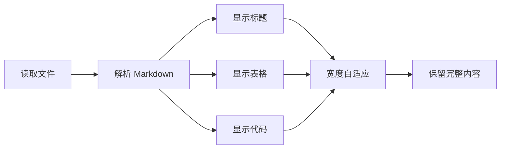

# Chat 文档预览

这是 **标准 Markdown**，包含中文、列表、表格和图表。正文不应混入 `path`、`content` 等工具协议字段，也不应显示被转义的换行。

## 检查清单

- 保留标题与段落
- 保留 **加粗**、*强调* 与 [外部链接](https://example.test/)
- [x] 已完成的项目
- [ ] 等待检查的项目

> 文档快照保留此次工具实际读取或写入的内容；当前文件通过单独的入口打开。

| 项目 | 内容 | 状态 | 备注 |
| --- | --- | --- | --- |
| Markdown | 正常标题与列表 | 可阅读 | 不把协议 JSON 当作文档 |
| 长路径 | C:/fixture/very-long-directory-without-spaces/another-very-long-directory/and-another-very-long-directory/README.md | 可换行 | 完整保留 |
| 长标识符 | LongIdentifier0123456789LongIdentifier0123456789LongIdentifier0123456789LongIdentifier0123456789LongIdentifier0123456789 | 可换行 | 不截断内容 |

## 源代码

```typescript
const message = "中文内容与真实换行";
const path = "C:\\fixture\\notes.md";
const longToken = "LongToken0123456789LongToken0123456789LongToken0123456789LongToken0123456789LongToken0123456789LongToken0123456789LongToken0123456789LongToken0123456789LongToken0123456789LongToken0123456789";
console.log(message, path, longToken);
```

## 修改差异

```diff
--- original.md
+++ updated.md
@@ -1 +1 @@
-原来的内容
+新的内容，以及 LongDiffToken0123456789LongDiffToken0123456789LongDiffToken0123456789LongDiffToken0123456789LongDiffToken0123456789
```

## 图表



## 公式

$$
\underbrace{a_1+a_2+a_3+a_4+a_5+a_6+a_7+a_8+a_9+a_{10}+a_{11}+a_{12}+a_{13}+a_{14}+a_{15}+a_{16}+a_{17}+a_{18}+a_{19}+a_{20}}_{\text{不可截断的完整公式}}
$$

## 图片


文档结束。END_OF_DOCUMENT_保留全文
