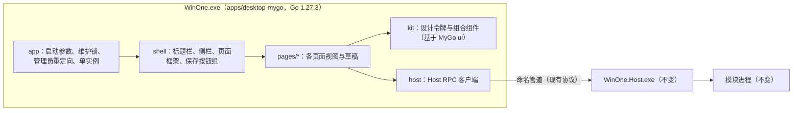

# MyGo 前端迁移

更新：2026-10-31。本文件记录 WinOne 桌面前端改写为 MyGo 原生界面的决策、方案、分工和验收方法。实施状态同步写入 [开发状态](development.md)。

## 1. 目标与决策

用户于 2026-10-30 明确要求：前端全面一比一转成 [egoist/mygo](https://github.com/egoist/mygo)，全面使用 [MyGo 原生 UI](https://mygo.egoist.dev/docs/ui) 组件。

- **改写对象**：WinOne.exe 的全部前端，即目前由 Rust + WRY/WebView2 承载的 React 页面（`apps/desktop/frontend`）。
- **还原基准**：仓库最新版 React 界面。页面、布局、分组、入口、选项、状态反馈和未保存保护一比一保留。
- **控件来源**：MyGo `ui` 包的组件及其无外观基础组件（Base）。图标继续使用本地 Lucide SVG，字体继续使用本地 Inter 与系统中文字体。
- **不变部分**：Host、各模块进程、配置格式和 Host RPC 方法名保持不变。截图画布（`modules/capture/NativeUI`）与结果窗（`apps/result-ui`）不在本次改写范围内。
- **分工**：用户允许同时最多两个子代理。外壳、共用组件、对照验收和提交由主 Agent 负责。
- **顺序**：Chat 与 OneBot 也改写为 MyGo，但排在其他页面之后。改写后 Cindy 上游更新改为手工移植，用户已知此取舍。
- **切换时机**：MyGo 版本达到全部页面一比一之前，安装器继续使用当前 Rust 桌面；完成全部验收后再切换统一构建默认值和固定安装器。

此决策取代 [Rust 桌面迁移可行性调研](Rust桌面迁移可行性调研.md) 第 5.1 节“需先同意 Go GUI 与 UI 重写”的前提，也取代 [Rust 桌面 UI 迁移](Rust桌面UI迁移.md) 中“直接复用 React 源码”的路线。

## 2. 版本与来源

| 项目 | 版本 | 用途 | 位置 |
| --- | --- | --- | --- |
| MyGo | v0.7.3（`6f28d7bb07b31177cf218e51586f6a5e99b38016`，MIT） | 原生窗口、`ui` 组件、渲染 | Go 模块缓存；源码参考 `dist/resources/sources/mygo-v0.7.3` |
| Go | 1.27.3（MyGo v0.7.3 的最低版本） | 编译 `apps/desktop-mygo` | `dist/resources/tools/go-1.27.3`，官方 zip SHA-256 `f26081f4…885fff` 已核对 |
| 结果窗的 MyGo | v0.2.13 预发布提交 + 本地补丁 | 不变 | 见 `third_party/mygo-patches` |

## 3. 架构

- **进程与生命周期**：沿用当前 Rust 桌面的启动参数、维护锁、管理员重定向（Host `--desktop-bootstrap`/`--desktop-control`）、单实例标识（`wails-app-winone-desktop-<sha256>` 系列名称）和 `WM_COPYDATA` 唤醒协议。关闭窗口时按“有未保存内容 → 确认；保持后台运行 → 隐藏；否则退出”处理。Host 托盘退出发送的 `WM_CLOSE(wParam=1)` 通过窗口子类化识别。
- **Host 改动**：Host 退出时按窗口类名枚举设置窗口。MyGo 的窗口类名固定为 `MyGoWindow`，因此 Host 同时接受 `WinOne.Desktop` 与 `MyGoWindow`，其余 PID 与进程身份核对不变。
- **线程**：MyGo 在主线程构建视图。Host 调用在后台 goroutine 执行，结果用 `Window.Update` 回到主线程。
- **包结构**：`app`（进程与窗口）、`host`（RPC）、`core`（页面环境、活动状态、异步）、`kit`（设计系统）、`i18n`（中英文案）、`shell`（外壳）、`pages/<页面>`。

## 4. 设计还原规则

- 颜色、字号、间距按 [WinOne 设置设计语言](WinOne设置设计语言.md) 的令牌实现，`kit` 是唯一控制点，页面不得自定义另一套颜色。
- 控件优先使用 MyGo 现成组件（Button、Switch、Checkbox、Radio、Select、Tabs、TextInput、NumberInput、Dialog、AlertDialog、Popover、Tooltip、Toast、List、Table、Split、Scroll、Markdown、CodeEditor、DiffViewer、Chart 等）。外观差异通过链式样式或对应 Base 调整，不另画交互控件。
- 每页以基线截图对照：`_temp/mygo-frontend-20261030/baseline/run3/<语言>-<主题>/`，覆盖中英、深浅色和全部一级、二级标签。生成方法见 `capture-baseline.mjs`（Edge 157 拒绝 Playwright 1.58.2 请求的 `/json/version/`，驱动改为先读取 WebSocket 地址再连接）。

## 5. 阶段与验收

| 阶段 | 内容 | 验收 |
| --- | --- | --- |
| 0 基础 | 模块与构建脚本、启动与生命周期、Host 客户端、`kit`、`i18n`、外壳、首页 | 构建与单元测试通过；隔离 Host 下真实窗口启动、导航、主题与语言切换、关闭到后台、托盘退出、重复打开唤醒均通过 |
| 1 设置类页面 | 设置、首页、程序管理、便捷功能、截图、划词助手、快捷助手、互联助手、AI 服务 | 每页功能对照表逐项通过；`ui.Tester` 覆盖保存、撤销、标签保护；真实窗口截图与基线对照（中英 × 深浅 × 520/1000 DIP），无横向溢出 |
| 2 闪聊 | 会话侧栏、消息区、输入栏与点对点传输 | 与手机端/另一台电脑互通；断线重连与晚加入历史 |
| 3 Chat、OneBot | Cindy 改写部分 | 按 Chat 与 OneBot 现有能力对照逐项验收 |
| 4 切换 | 统一构建默认 MyGo、安装器、性能 | 完整进程组冷/热启动、内存、CPU、句柄、退出回收；安装覆盖与卸载矩阵 |

每个页面的功能对照表写在本文件第 6 节，格式为“React 入口/行为 → MyGo 实现 → 验证证据”。未验证的项目不标记完成。

## 6. 页面清单与对照

| 页面 | React 来源（主要文件） | MyGo 包 | 状态 |
| --- | --- | --- | --- |
| 外壳 | `components/app-shell.tsx`、`window-titlebar.tsx`、`settings-save-bar.tsx`、`page-scroll-controls.tsx`、`ui/page-navigation.tsx` | `shell`、`kit` | 进行中 |
| 首页 | `features/modules.tsx`、`module-installation.tsx`、`module-removal.tsx` | `pages/overview` | 未开始 |
| 设置 | `components/settings-panel.tsx`、`appearance-settings.tsx`、`startup-settings.tsx`、`permission-settings.tsx`、`features/shortcuts.tsx`、`profiles.tsx`、`profile-import.tsx`、`updates.tsx`、`diagnostics.tsx` | `pages/settings` | 未开始 |
| 程序管理 | `features/wintray*.tsx` | `pages/wintray` | 未开始 |
| 便捷功能 | `features/convenience.tsx`、`always-on-top.tsx`、`timed-power.tsx`、`mouse-gestures*.tsx`、`directory-links*.tsx` | `pages/convenience` | 未开始 |
| 截图 | `features/capture*.tsx`（设置部分） | `pages/capture` | 未开始 |
| 划词助手、快捷助手 | `features/selection.tsx` 及相关 | `pages/selection` | 未开始 |
| 互联助手 | `features/interconnect*.tsx` | `pages/interconnect` | 未开始 |
| AI 服务 | `features/ai-*.tsx`、`magpie-*.ts` | `pages/aiservices` | 未开始 |
| 闪聊 | `interconnect-chat-entry.tsx`、`vendor/chitchatter` | `pages/flashchat` | 未开始 |
| Chat | `features/chat*.tsx`、`features/cindy` | `pages/chat` | 未开始 |
| OneBot | `features/onebot.tsx`、`features/cindy/bots` | `pages/onebot` | 未开始 |

## 7. 风险与待确认

- **网页内容**：Chat 右栏的浏览器标签页本身就是网页，只能用 MyGo 的 Web view（WebView2）显示。其余页面不使用网页。
- **点对点闪聊**：现有实现依赖浏览器的 WebRTC。原生实现需要 Go 的 WebRTC 库并与手机端协议兼容，开始阶段 2 前单独核对依赖、许可证和互通方案。
- **PDF、数学公式、Mermaid**：MyGo 没有 PDF 与 KaTeX 组件。Mermaid 继续使用结果窗已在用的一次性本地渲染器；PDF 与公式在阶段 3 前选型。
- **结果窗版本**：结果窗仍使用 MyGo v0.2.13。两个进程独立运行，暂不升级；完成全部页面后再评估统一版本。
