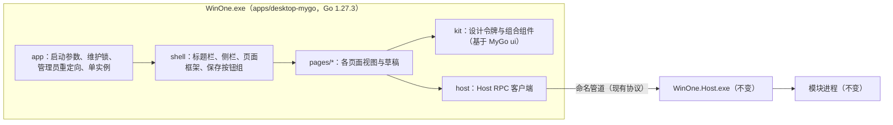

# MyGo 前端迁移

更新：2026-11-03。本文件记录 WinOne 桌面前端改写为 MyGo 原生界面的决策、方案、分工和验收方法。实施状态同步写入 [开发状态](development.md)。

## 1. 目标与决策

用户于 2026-10-30 明确要求：前端全面一比一转成 [egoist/mygo](https://github.com/egoist/mygo)，全面使用 [MyGo 原生 UI](https://mygo.egoist.dev/docs/ui) 组件。

- **改写对象**：WinOne.exe 的全部前端，即目前由 Rust + WRY/WebView2 承载的 React 页面（`apps/desktop/frontend`）。
- **还原基准**：仓库最新版 React 界面。页面、布局、分组、入口、选项、状态反馈和未保存保护一比一保留。用户另行允许：迁移时界面、层级和样式都可以重构，前提是确实更好（参考 [impeccable](https://github.com/pbakaus/impeccable)），功能与入口不减。
- **控件来源**：MyGo `ui` 包的组件及其无外观基础组件（Base）。图标继续使用本地 Lucide SVG，字体继续使用本地 Inter 与系统中文字体。
- **不变部分**：Host、各模块进程、配置格式和 Host RPC 方法名保持不变。
- **截图与结果窗**（用户 2026-10-31 决定）：截图不迁移到 MyGo，画布、选区与标注保持现状；截图工具栏及其菜单的外观与设置窗口的 `kit` 统一，控件仍是原生 ToolStrip（约定见 [截图与划词](working-rules/capture-selection.md)）。划词助手、快捷助手的结果窗与划词工具栏迁移到 MyGo v0.7.3，并重构界面。
- **网页内容**（用户 2026-10-31 决定）：Magpie 路由页、第三方插件管理、脱敏记录、插件扩展页，以及 Chat 的内置浏览器与 HTML 预览，用 MyGo WebView（`ui.WebView`）嵌入。网页原有的 postMessage 协议不变，由 `apps/desktop-mygo/web` 转给 Go。
- **闪聊**：原生重写，并与现有 Chitchatter/Trystero 房间互通。
- **分工**：用户允许同时最多两个子代理。外壳、共用组件、对照验收和提交由主 Agent 负责。
- **顺序**：Chat 与 OneBot 也改写为 MyGo，但排在其他页面之后。改写后 Cindy 上游更新改为手工移植，用户已知此取舍。
- **Chat 与 OneBot 的方式**（用户 2026-11-01 决定，混合方案）：会话列表、消息流、输入框、排队、审批、提问、计划等核心交互原生重写；代码编辑器、差异审阅、PDF、终端、内置浏览器与 HTML 预览、自动化整页及 OneBot 管理页在 MyGo WebView 中运行现有 React/Cindy 组件。功能清单见 [Chat 对照](mygo-parity/chat.md)。
- **切换时机**：完整迁移仍须全部页面验收后再切换统一构建默认值（当前仍为 Rust）。用户于 2026-10-31 另行要求先测试当前成果、暂缓闪聊/Chat/OneBot：本轮显式使用 `build/build.ps1 -DesktopImplementation MyGo`，2026-11-01 已更新固定测试安装器；这三个页面在本测试版暂不可用，原后台实现和数据保留，不把测试包等同于全面迁移完成。

此决策取代 [Rust 桌面迁移可行性调研](Rust桌面迁移可行性调研.md) 第 5.1 节“需先同意 Go GUI 与 UI 重写”的前提，也取代 [Rust 桌面 UI 迁移](Rust桌面UI迁移.md) 中“直接复用 React 源码”的路线。

## 2. 版本与来源

| 项目 | 版本 | 用途 | 位置 |
| --- | --- | --- | --- |
| MyGo | v0.7.3（`6f28d7bb07b31177cf218e51586f6a5e99b38016`，MIT） | 原生窗口、`ui` 组件、渲染 | Go 模块缓存；源码参考 `dist/resources/sources/mygo-v0.7.3` |
| Go | 1.27.3（MyGo v0.7.3 的最低版本） | 编译 `apps/desktop-mygo` | `dist/resources/tools/go-1.27.3`，官方 zip SHA-256 `f26081f4…885fff` 已核对 |
| 结果窗的 MyGo | v0.7.3（原版模块，与设置窗相同） | `apps/result-ui`；Go 1.27.3 | 已去掉 `result-ui-overlay.ps1` 和 `third_party/mygo-patches`，来源/二进制许可校验通过 |

## 3. 架构

- **进程与生命周期**：沿用当前 Rust 桌面的启动参数、维护锁、管理员重定向（Host `--desktop-bootstrap`/`--desktop-control`）、单实例标识（`wails-app-winone-desktop-<sha256>` 系列名称）和 `WM_COPYDATA` 唤醒协议。关闭窗口时按“有未保存内容 → 确认；保持后台运行 → 隐藏；否则退出”处理。Host 托盘退出发送的 `WM_CLOSE(wParam=1)` 通过窗口子类化识别。
- **Host 改动**：Host 退出时按窗口类名枚举设置窗口。MyGo 的窗口类名固定为 `MyGoWindow`，因此 Host 同时接受 `WinOne.Desktop` 与 `MyGoWindow`，其余 PID 与进程身份核对不变。
- **线程**：MyGo 在主线程构建视图。Host 调用在后台 goroutine 执行，结果用 `Window.Update` 回到主线程。
- **安装启动检查**：`app/probe_windows.go` 实现现有 `--check-ui <nonce> --probe-root <目录>` 握手。先验证配套 Host，再以独立目录和只读私有管道打开正式 `shell`，等待读取与 UI 回调、原生绘制和图像导出后正常退出；不启动用户的 Host 运行实例或 Worker，不读取用户配置。失败只写 stderr，不弹消息框；保留安装维护锁下的只读入口。`TestNativeDesktopProbeUnderMaintenance` 与隔离安装矩阵已通过。
- **包结构**：`app`（进程与窗口）、`host`（RPC）、`core`（页面环境、活动状态、异步）、`kit`（设计系统）、`i18n`（中英文案）、`shell`（外壳）、`pages/<页面>`。

## 4. 设计还原规则

- 颜色、字号、间距按 [WinOne 设置设计语言](WinOne设置设计语言.md) 的令牌实现，`kit` 是唯一控制点，页面不得自定义另一套颜色。
- 控件优先使用 MyGo 现成组件（Button、Switch、Checkbox、Radio、Select、Tabs、TextInput、NumberInput、Dialog、AlertDialog、Popover、Tooltip、Toast、List、Table、Split、Scroll、Markdown、CodeEditor、DiffViewer、Chart 等）。外观差异通过链式样式或对应 Base 调整，不另画交互控件。
- 每页以基线截图对照：`_temp/mygo-frontend-20261030/baseline/run3/<语言>-<主题>/`，覆盖中英、深浅色和全部一级、二级标签。生成方法见 `capture-baseline.mjs`（Edge 157 拒绝 Playwright 1.58.2 请求的 `/json/version/`，驱动改为先读取 WebSocket 地址再连接）。

## 5. 阶段与验收

| 阶段 | 内容 | 验收 |
| --- | --- | --- |
| 0 基础 | 模块与构建脚本、启动与生命周期、Host 客户端、`kit`、`i18n`、外壳、首页 | 构建与单元测试通过；隔离 Host 下真实窗口启动、导航、主题与语言切换、关闭到后台、托盘退出、重复打开唤醒均通过 |
| 1 设置类页面 | 设置、首页、程序管理、便捷功能、截图、划词助手、快捷助手、互联助手、AI 服务 | 每页功能对照表逐项通过；`ui.Tester` 覆盖保存、撤销、标签保护；真实窗口截图与基线对照（中英 × 深浅 × 520/1000 DIP），无横向溢出 |
| 2 闪聊 | 会话侧栏、消息区、输入栏与点对点传输 | 与手机端/另一台电脑互通；断线重连与晚加入历史 |
| 3 Chat、OneBot | Cindy 改写部分 | 按 Chat 与 OneBot 现有能力对照逐项验收 |
| 4 切换 | 统一构建默认 MyGo、安装器、性能 | 完整进程组冷/热启动、内存、CPU、句柄、退出回收；安装覆盖与卸载矩阵 |

每个页面的功能对照表写在 `docs/mygo-parity/<页面>.md`（第 6 节列出），格式为“React 入口/行为 → MyGo 实现 → 验证证据”。未验证的项目不标记完成。

**本轮测试交付（2026-11-01）**：`dist/release/WinOne-setup.exe` 为显式 MyGo 预览包（5279 文件，263674448 字节）。MyGo/结果窗全套测试与 vet、源码和二进制许可、原生启动、结果窗中英/深浅 4 组实窗、用量 35 张渲染截图、14 次隔离安装/覆盖/修复/回滚/卸载操作及 Defender 扫描通过。证据在 `_temp/mygo-test-installer/`，SHA-256 和详细范围见 `docs/development.md` 与 `dist/release/release-info.json`。没有操作真实安装或配置；完整进程组性能、真实账号和混合 DPI 等仍待验收。

## 6. 页面清单与对照

逐项对照与验证状态写在 `docs/mygo-parity/<页面>.md`；“已实现”表示代码已接入，不等于全部实窗及真实账号流程已验收，表内“待验证”项仍需证据。

| 页面 | React 来源（主要文件） | MyGo 包 | 状态 |
| --- | --- | --- | --- |
| 外壳 | `components/app-shell.tsx`、`window-titlebar.tsx`、`settings-save-bar.tsx`、`page-scroll-controls.tsx`、`ui/page-navigation.tsx` | `shell`、`kit` | 已实现 |
| 首页 | `features/modules.tsx`、`module-installation.tsx`、`module-removal.tsx` | `pages/overview` | 已实现；`TestHomeMatchesTheSidebar` 保证首页功能及顺序与侧栏上半区一致 |
| 设置 | `components/settings-panel.tsx`、`appearance-settings.tsx`、`startup-settings.tsx`、`permission-settings.tsx`、`features/shortcuts.tsx`、`profiles.tsx`、`profile-import.tsx`、`updates.tsx`、`diagnostics.tsx` | `pages/settings` | 已实现（[对照](mygo-parity/settings.md)） |
| 程序管理 | `features/wintray*.tsx` | `pages/wintray` | 已实现（[对照](mygo-parity/wintray.md)） |
| 便捷功能 | `features/convenience.tsx`、`always-on-top.tsx`、`timed-power.tsx`、`mouse-gestures*.tsx`、`directory-links*.tsx` | `pages/convenience` | 已实现（[对照](mygo-parity/convenience.md)） |
| 截图 | `features/capture*.tsx`（设置部分） | `pages/capture` | 已实现（[对照](mygo-parity/capture.md)） |
| 划词助手、快捷助手 | `features/selection.tsx` 及相关 | `pages/selection` | 已实现（[划词](mygo-parity/selection.md)、[快捷助手](mygo-parity/quick-assistant.md)） |
| 互联助手 | `features/interconnect*.tsx` | `pages/interconnect` | 已实现（[对照](mygo-parity/interconnect.md)） |
| AI 服务 | `features/ai-*.tsx`、`magpie-*.ts` | `pages/aiservices` | 已实现（[对照](mygo-parity/ai-services.md)）；用量统计见 [对照](mygo-parity/ai-usage.md) |
| 结果窗与划词工具栏 | `apps/result-ui`（MyGo v0.2.13） | `apps/result-ui`（MyGo v0.7.3） | 已接入测试包；单元回归、构建/许可、原生进程与样式通过（[对照](mygo-parity/result-window.md)） |
| 截图工具栏外观 | `modules/capture/NativeUI`（原生 ToolStrip） | 不迁移；`NativeStyle.cs` 同步 `kit` 令牌 | 已接入测试包；私有桌面渲染验证，Windows 11 菜单圆角未实窗验证 |
| 闪聊 | `interconnect-chat-entry.tsx`、`vendor/chitchatter` | `pages/flashchat`、`flashchat` | 已实现（[对照](mygo-parity/flash-chat.md)）；与 React/Chitchatter 页面本机互通 21/21，跨网络与实窗待验证；2026-11-01 的测试安装器中不可用 |
| Chat | `features/chat*.tsx`、`features/cindy` | `pages/chat`、`chat/model`、`webui` | 核心交互、侧面板、自动化、设置已实现（混合方案，[对照](mygo-parity/chat.md)）；Bot 模式随 OneBot；真实 Host 联调待验证；2026-11-01 的测试安装器中不可用 |
| OneBot | `features/onebot.tsx`、`features/cindy/bots` | `pages/onebot`、`webui` | 已实现：整页在网页视图中运行（[对照](mygo-parity/onebot.md)）；队友对话暂为 React Chat，改原生待确认；真实 Host 联调待验证 |

## 7. 风险与待确认

- **网页内容**：Chat 的浏览器与 HTML 预览、Host 提供的网页（第 1 节）用 MyGo WebView 显示。桥接有单元测试；真实窗口中的主题同步、高度和原生请求尚待验证。
- **点对点闪聊**：原生实现用 Pion WebRTC 和 Go 版 Trystero 线协议，依赖与许可已记录并校验。本机互通测试通过；手机浏览器、跨网络（公共 tracker、TURN）尚未验证。
- **PDF、数学公式、Mermaid**：MyGo 没有 PDF 与 KaTeX 组件。Mermaid 继续使用结果窗已在用的一次性本地渲染器；PDF 与公式在阶段 3 前选型。
- **结果窗版本**：已接入 MyGo v0.7.3，改用公开选区、输入事件、工具窗口和 Markdown 接口，本地补丁已删除。当前单元回归与中英/深浅实窗通过；真实供应商请求、中文输入法、多屏/DPI 和长期资源仍待验收。
