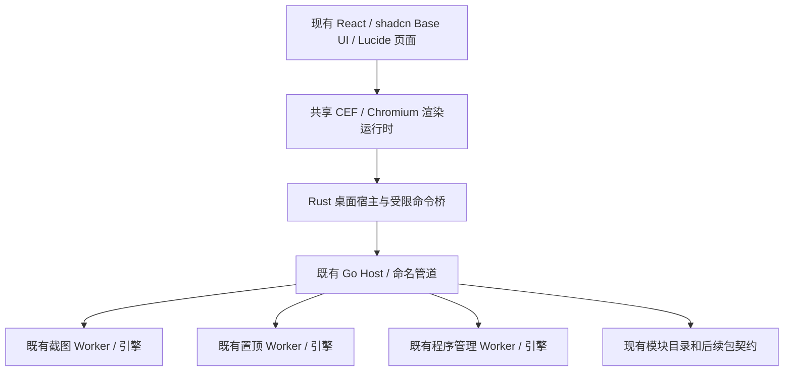

# Rust 桌面迁移可行性调研：Codex、MyGo、组件与图标

调研日期：2026-10-05。状态：**资料与安装包静态核查完成；未实施迁移，未做新方案性能或完整体验验收。**

后续决定：用户已在迁移聊天中明确选择“按本聊天继续迁移”。本报告保留此前调研的范围与比较，不作为当前实施的暂停条件；当前路线见 [Rust 桌面 UI 迁移](Rust桌面UI迁移.md)。

## 1. 当前要求与结论

本轮边界：只迁移 WinOne 桌面端；一比一保留现有布局、界面、功能分组和全部功能；不重写 Go Host 或截图、置顶、程序管理引擎；保留后续模块接入能力。用户进一步明确：**不要 WebView2，直接参考 OpenAI Codex 桌面版实际采用的组件和图标。**

结论：

1. **Codex 桌面版不是“用 Rust 原生组件绘制全部 UI”的范例。** 本机安装包显示 Electron 工程/API、名为 **Owl** 的打包运行时、随包携带的 Chromium，以及 React 前端。不能把它的 Rust App Server 当作 Rust GUI 的证据。
2. **Codex 的 UI 技术可以不依赖 WebView2，但仍然依赖浏览器渲染。** “不使用 WebView2”与“不使用任何 Chromium/HTML/CSS/JavaScript”是不同要求，本次不擅自将前者扩大为后者。
3. 组件层已确认 **React、Radix primitives、OpenAI 组件封装、Tailwind 4 / CSS Modules**。公开可参考的组件库是 **`@openai/apps-sdk-ui`**，不是 Rust crate，也不能据此断言 Codex 的全部页面都来自该公开库。
4. 图标至少包含 **OpenAI SVG 图标体系和 Lucide**。已将安装包中的 `Agent` 图标与公开 Apps SDK UI 的图标逐条比对，4 条 SVG path 数据一致；另在安装包中读到真正调用 `createLucideIcon` 的 `Settings` 代码。
5. **WinOne 现有 shadcn/Base UI 与 Lucide 不必因排除 WebView2而更换。** 若 Rust 桌面宿主改用 CEF/Chromium，仍可承载同一份 React 页面与图标；若要求完全不使用浏览器渲染，则 React 控件不能直接用于 Rust 原生 GUI，必须重写界面，这与当前“不另写一套 UI”约定冲突。
6. 在“Rust 宿主 + 无 WebView2 + 直接复用现有 UI”三项约束下，**Rust + CEF 是值得下一步做受控原型的候选，不是已批准或已验证的最终方案**。它并非 Codex 的已确认实现，不能借 Codex 为其性能背书。
7. 按用户要求新增 **MyGo** 对照项：网页模式在 Windows 下仍使用 WebView2；原生模式不使用 WebView2，但属于 Go GUI，需重写现有 React 界面。将其列为**放宽 Rust 与原 UI 源码直接复用两项约束后的条件备选**，并不视为用户已经同意这些取舍。详见第 5.1 节。

## 1.1 长期收益：不是 WebView2 与 React 的二选一

用户进一步询问两者的未来收益。这是在比较方案，**不视为撤销“不要 WebView2”的约束，也不构成实施授权**。

- **WebView2** 属于宿主/渲染运行时，负责运行 HTML、CSS、JavaScript。
- **React + Tailwind + Radix** 属于前端框架、样式和交互组件，可以运行在 WebView2、Electron 或 CEF 中。
- 所以真正的决策有两项：运行时选择 WebView2 还是随包 Chromium；组件选择保留 WinOne 当前 Base UI，还是重写适配为 Radix。

| 对比维度 | Rust + WebView2 + 现有 React UI | Rust + CEF/自带 Chromium + 同一 UI |
| --- | --- | --- |
| 分发与运行时维护 | Evergreen 运行时可共享，由微软维护更新；仍须检测依赖及支持离线安装 | 自己打包、跟进 Chromium 安全补丁、处理回滚与全部辅助进程 |
| 版本控制 | Evergreen 会更新，需持续兼容回归；也可选固定版，但会损失共享分发优势 | 可以锁定随包版本；相应承担更新时效和安全维护责任 |
| 包体和工程投入 | Windows 优先产品通常更有优势；不代表进程内存或输入延迟自动更低 | 通常更多运行时文件和集成工作；不能凭框架名承诺性能收益 |
| UI 生态和模块扩展 | 保留同一 React 组件与受限 Host 契约 | 同样能保留；不因换内核自然获得额外模块能力 |
| 对当前要求 | 被此前用户明确排除；只有重新允许才能进入实施选项 | 无 WebView2 的候选，需要实测，尚未选定 |

**条件性建议**：若将来重新允许 WebView2，按 WinOne 的 Windows 工具集、轻量和长期维护目标，优先评估“Rust 宿主 + WebView2 + 现有 React/Tailwind/shadcn/Base UI/Lucide”。若继续排除 WebView2，则继续评估 Rust + CEF，不把它包装成成本更低或必然更快的方案。微软关于进程与分发的依据见 [S12]。

前端则优先保留现有设计系统。没有发现仅为了迁移 Rust 而从 Base UI 换 Radix 的必要收益；二者 API 和交互细节不同，会增加回归成本。参考 Codex 应借鉴职责分层和经过核查的组件行为，而不是照搬完整技术栈。

## 2. 证据范围与方法

- 工作区基点：`5b28fd9`，包含既有未提交改动。实际源码优先于旧文档，未回退或覆盖这些改动。
- Codex 样本：本机已安装的 **OpenAI Windows x64 MSIX**，不是同名笔记软件、CLI 单独发行包或第三方克隆。
- 只读检查 `AppxManifest.xml`、运行时元数据、PE 版本信息、`app.asar` 目录和选定 JS/CSS/SVG、第三方许可证；不启动或修改 Codex，不读取账户、会话、浏览器用户数据。
- 对照 OpenAI 官方工程文章、公开 Apps SDK UI 源码，以及 Electron、CEF、Rust GUI 官方文档。
- ASAR 只提取选定文件到忽略目录，未执行包内脚本，未把 Codex 私有产品代码、字体或图标复制进 WinOne 源码。
- 本地原始证据与只读核查脚本：`_temp/rust-feasibility-20261005/`；8 项静态事实检查见 `codex-installed/verification.json`。这些检查**不是**应用功能、视觉或性能测试。

本文结论针对上述安装版本和公开资料，不外推到所有历史/未来版本、macOS 或 Linux。

## 3. Codex 桌面版实际采用什么

### 3.1 版本与桌面宿主

| 项目 | 核查结果 | 直接证据（相对安装目录） |
| --- | --- | --- |
| MSIX 身份与版本 | `OpenAI.Codex`，`26.930.3930.0`，x64 | `AppxManifest.xml` |
| 应用内部版本 | `26.930.31730`，build `12947` | `app/resources/app.asar` 内 `package.json` |
| 桌面工程 | `openai-codex-electron`；主入口 `.vite/build/early-bootstrap.js` | 同上 |
| Electron API / 构建体系 | `electron` 开发依赖 `42.3.0`；Electron Forge；入口实际 `require("electron")` | `package.json`、`.vite/build/early-bootstrap.js` |
| 实际打包运行时 | `runtimeName: "owl"` | `app/resources/owl-electron-app.json`、`owl-app.ini` |
| Chromium | 随包有 `chrome.dll`、Chromium `.pak`、V8 snapshot、GPU 相关库；`chrome.dll` 版本 `154.0.8037.98` | `app/` 目录与 PE 版本信息 |
| UI 资源 | 本地 `webview/index.html` 与拆分 JS/CSS、字体、SVG | `app.asar` 内 `webview/` |
| 功能引擎 | 单独携带 Codex 可执行文件；官方文档说明桌面客户端通过 App Server 复用 Rust 核心 | `app/resources/codex.exe`；[S1][S2] |

**精确说法：这是采用 Electron API/工程体系、在本机版本使用 Owl/Chromium 运行时的桌面应用。** 不宜省略 Owl 而说“这个包运行的就是标准 Electron 42.3.0”；开发依赖版本不能替代实际运行时版本。

本机包内还包含 ChatGPT 页面与资源，MSIX 显示名称和启动入口已有 `ChatGPT` 标记。本文保留其真实 `OpenAI.Codex` 身份与版本，不把某个依赖的出现自动归因于 Codex 的所有页面。

OpenAI 官方文章 [S1] 明确：桌面客户端与 IDE 可捆绑已测试的 App Server 二进制，启动为子进程，通过双向 JSON-RPC over stdio 通信。值得借鉴的是**界面与功能引擎分离**，不是把 WinOne 的既有协议、Host 和三个模块改成 Codex 协议。

### 3.2 组件和样式

| 层次 | 已确认内容 | 证据强度与限制 |
| --- | --- | --- |
| 渲染框架 | React / React DOM；主共享 bundle 内版本为 `19.2.7` | 直接读取运行时代码，不仅依据许可证清单 |
| 基础交互 | Radix 的 Dialog、Menu、Popover、Tooltip、Slider 等 primitives | 共享 bundle 中有 `__scopeDialog`、`radix.slottable`、Radix 焦点保护及弹层实现；主页面也引用 Radix 定位变量 |
| 产品控件 | OpenAI 风格的 Button、输入、菜单和弹层封装，使用统一设计令牌 | Button 具有 `color`、`variant`、`uniform`、`loading`、`opticallyAlign` 等 API；不是系统 Win32 Button |
| 可公开复用的对应库 | `@openai/apps-sdk-ui` `0.2.2`，MIT | 安装包列出此库；其公开 README、Button API 与包中实现存在直接对应。包中还有 `squircle` 等扩展，不能说公开版本等于整个桌面 UI |
| 样式 | Tailwind 4 + CSS Modules + CSS 变量 | HTML 明确设置 Tailwind layer 顺序；有 `_Button_…` 模块类名与设计令牌。许可证同时列出 Tailwind `4.0.17`、`4.3.3`，不强行归成全应用单一版本 |
| 字体 | 包内有本地 OpenAI Sans、OpenAI Serif 字体；CSS 使用 OpenAI Sans | 只说明来源与加载方式，不代表这些品牌字体可直接用于 WinOne |

公开 Apps SDK UI [S3] 提供的组件包括：

- `Button` / `ButtonLink`、`Input`、`Textarea`、`Checkbox`、`Switch`、`RadioGroup`；
- `Select`、`SelectControl`、`Menu`、`Popover`、`Tooltip`；
- `Alert`、`Badge`、`Avatar`、`Slider`、`SegmentedControl`；
- `DatePicker`、`DateRangePicker`、`Markdown`、`CodeBlock`、`Icon` 等。

其公开要求为 **React 18/19 + Tailwind 4**，基础交互使用 Radix。它是可参考的 React 设计系统，**没有因此变成能直接导入 Rust 的原生控件库**。

本次没有获得 Codex 私有桌面仓库，也未把“找到 Radix”推断成“Codex 就是 shadcn/ui”。WinOne 当前使用的是 **shadcn `base-nova` + Base UI**；Base UI 与 Radix 不是同一套 API。

### 3.3 图标：不是只有一种来源

| 来源 | 安装包证据 | 可复用边界 |
| --- | --- | --- |
| OpenAI 公开 SVG 图标 | `webview/assets/agent-883532880f0f.svg` 与 Apps SDK UI `Icon/svg/Agent.tsx` 的 4 条 path 数据完全一致 | 从公开 MIT 仓库取得相应资源，保留许可；不从产品包搬运整套资产 |
| OpenAI 产品图标封装 | 主共享 bundle 有带名称、画布尺寸、`inkBounds` 与 SVG body 的图标资产，例如 `plus-md-light-24`、`magnifying-glass-md-light-24` | 证明存在产品自己的图标系统；本次未确认整套是否公开、是否全部属于 Apps SDK UI，不能宣称可整套复制 |
| Lucide | `settings-8KXOPtTT-463f441f621c.js` 导入 `createLucideIcon` 并定义 `Settings`；还存在 Lucide 风格的静态 SVG | 证明确有 Lucide 代码和资源，不证明所有主导航图标都使用 Lucide |
| 品牌/应用图标 | 应用 ICO、OpenAI 标识及第三方应用 Logo | 品牌资产单独核对权利，不因外围代码开源就视为任意可用 |

安装包第三方声明列出 `lucide-react 0.456.0`。WinOne 已锁定 `lucide-react 1.27.0`，**无需为了“参考 Codex”而降级**。

公开 OpenAI 图标入口是 `@openai/apps-sdk-ui/components/Icon` [S4]。这些是渲染 SVG 的 React 组件；SVG 几何本身也可以作为本地资源交给 Rust 图形栈。Lucide 同理 [S5]，不要求必须有官方 Rust 图标 crate。

### 3.4 关键证据指纹

以下用于将结论绑定到实际样本，不是发布者签名验证结果：

| 文件 | 字节数 | SHA-256 |
| --- | ---: | --- |
| `app/resources/app.asar` | 549383582 | `af98213984ec4556778ef9276193d51460153fb9b30fded882d503637b84abba` |
| `app/resources/THIRD_PARTY_NOTICES.txt` | 3212713 | `921a9926b765a84b5d4b5a4d7a9b9d8c6029dad59d83695a74ee3495405aecbd` |
| `app/chrome.dll` | 327084336 | `9ccf68d0580105bdb99b3ef5119829ca637d0d10251c58c984adbba59f37e7e0` |
| ASAR 内 `package.json` | 5605 | `e33f3e624016a3e19e1528b7d08765c8e6febf3bacdf4467f86d4c45624fff66` |

这些文件大小只证明该样本携带实质运行时与大量资源，**不代表 WinOne 的未来包体，也不是内存、启动速度或卡顿的测量**。

## 4. WinOne 当前组件能否保留

仓库实查：

| 当前内容 | 位置 / 锁定版本 | 无 WebView2 迁移中的处理 |
| --- | --- | --- |
| React 页面与公共壳 | `apps/desktop/frontend/src/main.tsx`、`components/app-shell.tsx`、`features/`；React `19.3.0` | 原样作为本地前端资源保留；只替换宿主接口 |
| shadcn/Base UI | `components.json`：`base-nova`；CLI `4.21.0`；`@base-ui/react 1.8.0` | 不为了迁移改成 Codex 的 Radix / Apps SDK UI，不另复制一份页面 |
| 共享样式与字体 | `src/styles/shadcn.css`、`src/style.css`；Tailwind `4.3.3`、Geist `5.3.0` | 保留布局、令牌和字体基准，基础运行不依赖 CDN |
| 图标 | `lucide-react 1.27.0`；`internal/branding/logo.png` | 浏览器承载路线直接复用；原生图形路线可用同源 SVG/PNG/ICO |
| 截图 UI | `capture-app.tsx`、`features/capture-*`；Konva `10.7.0`、React Konva `19.3.0` | 继续同窗口选区与标注，不换独立工具栏、不缩回设置页；渲染器迁移需专项验证 |
| 桌面桥接 | `src/bridge.ts` 的 `window.go.main.App` 与事件端口 | 这是 Wails 宿主契约，不是 React 本身限制；在 Rust 边界提供受限适配 |
| Rust 原型 | `apps/desktop-rust/`，`component-ui` feature 使用 `wry = 0.57.0` | **Windows 下依赖 WebView2，已被用户新约束排除**；只可评估复用不依赖 WRY 的协议、状态和生命周期逻辑 |
| 已有构建 | `build/build-desktop-rust.ps1 -ComponentUI`、`apps/desktop-rust/build.rs` | 已有“构建同一前端并嵌入资源”的代码，不能把它误报为不存在；本轮未构建或验证它，也不将其继续作为新目标 |

**图标不是主要障碍，DOM/React 控件运行环境才是。** 更换图标或把 TSX 改写成某个“Rust 版 shadcn”都不能自动获得一比一界面与完整交互。

## 5. 排除 WebView2 后的方案比较

| 方案 | WebView2 | 桌面宿主是否 Rust | 直接复用现有 React/UI | 判断 |
| --- | --- | --- | --- | --- |
| Rust + CEF/Chromium | 不需要 | 可以；CEF 本身为 C/C++ | 可以承载同一份构建产物 | 三项硬约束的候选交集；需要原型、接口和资源验证 |
| Electron + 现有 UI + Rust 桥接/辅助进程 | 不需要 | 主桌面壳仍是 Electron，不是纯 Rust | 可以 | 可借鉴 Codex 的分层；不能把它称作桌面宿主已全面迁移 Rust |
| 直接复用 Codex Owl | 本机样本用自带 Chromium | 本次未确认内部实现语言 | 本机有 React 前端 | 未获得可供 WinOne 使用的公开运行时 SDK/分发许可，不列为可执行方案 |
| MyGo 网页模式 | Windows 下需要 | 否，Go 宿主 | 可以，但要适配 MyGo 的 Go/TS 桥 | 已纳入对照；不满足当前无 WebView2 / Rust 宿主要求 |
| MyGo Native UI | 不需要，前提是所有 UI 窗口均走原生模式 | 否，Go 的 `ui` 工具包 | 不能直接复用；SVG 图标可复用 | 有性能评估价值的条件备选；需先同意 Go GUI 与 UI 重写 |
| Rust + Slint | 不需要 | Rust 接口 + Slint UI 描述 | 不能直接复用 TSX/DOM 控件 | 有原生 GUI 能力；必须重写界面，与当前直接复用约定冲突 |
| Rust + iced | 不需要 | 是 | 不能直接复用 | 同上；可使用 SVG，但不是原控件替换即完成 |
| Rust + egui / Win32 控件 | 不需要 | 可以 | 不能直接复用 | 不能用另一套原生/即时模式界面冒充现有设计；不恢复被否定的自绘路线 |
| 默认 Tauri/WRY、Dioxus Desktop 的 WebView 路线 | Windows 下需要 | 有 Rust 部分 | 部分方案可以 | **当前排除**；不能通过改框架名或改写为 Rust 语法隐藏 WebView2 依赖 |

CEF 官方提供嵌入 Chromium 的 C/C++ 接口 [S7]；`tauri-apps/cef-rs` 提供 Rust 绑定和 Windows x64 示例 [S8]。本次查到 `cef 154.4.0+154.0.33`。这是独立 CEF 绑定，**不能因仓库组织名是 tauri-apps 就误称“默认 Tauri 已不使用 WebView2”**。

没有下载 CEF 二进制、安装新依赖或执行示例。CEF/Chromium 需要随产品维护运行时、安全更新、多进程生命周期与许可证，不能仅凭 Rust 的可执行文件很小就判定轻量。

如果用户后续还要求“不要任何浏览器内核”，应先明确接受 UI 重写与组件更换的范围；不能自行放弃现有源码复用约定。此次只排除 WebView2，不预先替用户作这个决定。

### 5.1 新增候选：MyGo（2026-10-05）

用户提供 [egoist/mygo](https://github.com/egoist/mygo)，要求纳入考虑。**已纳入比较，不安装、不接入，也不据此改变既有技术和界面约束。**

#### 核验基点

- 源码锁定：`e112810768ddbc19f8613c99d875a1967ca31af5`，2026-10-04 的主分支提交；与发布 tag 分开记录。
- 本次查询最新 release：`v0.2.7`，发布于 2026-10-04，tag 指向 `50be73e3d1ba69b8e46641cefd45460e14932ea2`。本节源码判断基于前述较新的主分支，不将其所有改进归入 v0.2.7。
- 根许可证为 **MIT**；直接依赖含 `purego`、`go-text/typesetting`、`x/image`，实际分发仍须核对传递依赖及图标许可证。
- `go.mod` 要求 **Go 1.27.1**，而当前 WinOne 根模块是 Go 1.26.2。若以后采用，应明确独立桌面模块工具链或升级范围，不能偷偷改动现有模块构建。
- 公开仓库创建于 **2026-09-26**，当前处于 0.2.x 快速迭代阶段。仓库有跨平台测试与 GUI CI 配置，但本次未运行或核验对应流水线结果；“Ready to ship”不是 WinOne 产品验收证据。

#### 两条路线已由源码确认

| 路线 | 真实实现 | 对 WinOne 的意义 |
| --- | --- | --- |
| 网页 | Go 窗口宿主 + 系统 WebView；Windows 用 WebView2，静态 HTML/CSS/JS 构建资源可嵌入二进制，生成 TypeScript 调用 Go 的接口 | 能承载现有 React 页面，但仍需 WebView2；不是 Rust 迁移路线，也没有因换框架就消除浏览器成本 |
| 原生 | `WindowOptions.Content: ui.View(...)`；Go 编写控件树，MyGo 自行渲染，Windows 使用 Direct3D 11，可回退软件绘制 | 不需要 HTML/JS/WebView2；必须迁移 UI 布局、状态和交互代码，不能直接运行 shadcn/Base UI、Radix 或 Konva |

`internal/windows/window.go` 的 `NewWindow` 仅在 `!o.Surface` 时调用 `startEnvironment` 与 `createWebView`；原生分支创建 `newSurface`。这比仅看 README 的“不需要 webview”更明确。`content.go` 与 `ui/svg.go` 也确认其内容/图标接口是 Go API，并非 Rust 绑定。

这里的 **Native UI 指框架自绘的原生渲染，不是直接使用 Windows 系统按钮和表单控件，也不是现有网页组件的原生版**。使用现成控件封装可以减少从零绘制，但仍需对照 WinOne 最新设计，不能复用此前被否定的自绘布局作为交付基准。

#### 组件、图标与潜在收益

| 能力 | 已核查的支持 | 尚需验证 |
| --- | --- | --- |
| 表单和操作 | Button、Checkbox、Switch、Radio、Select、Slider、TextInput、NumberInput、Form、字段错误等 | 与现有保存、取消、禁用、错误关联和快捷键录入的行为一致 |
| 布局与程序列表 | Row/Column、Grid、Split、Scroll、虚拟 List/Table、Sidebar、Tabs | 单行程序行、序号下拉、双区独立滚动、分栏拖动与窄窗布局，不能只证明“有列表控件” |
| 弹层与导航 | Dialog、Popover、Menu、Tooltip、Toast、Router 等 | 未保存保护、点击框外继续编辑、焦点恢复、键盘与主题细节 |
| 图标 | `ui.ParseSVG` / `ui.Icon`；官方图标文档明确列出 Lucide、Heroicons、Tabler、Material Symbols | 可保留现有 Lucide 的同源 SVG；`lucide-react` 组件不能直接导入 Go。SVG 解析不支持 text、嵌入图片、pattern、marker、filter 等完整浏览器能力，需逐资源检查 |
| 性能机制 | 原生窗口不创建浏览器；按输入/失效/动画请求帧；虚拟集合、GPU 绘制；所查主分支有慢帧统计 | 这是减少开销的机制，不是已证实低于 WebView2/CEF 的 WinOne 数据；仍有 Go GC、文本布局及 GPU 资源成本 |
| 系统交互 | 文档及 Windows 源码有 IME、UI Automation、DPI、系统主题/偏好适配 | 中文输入、混合 DPI、高对比度、屏幕阅读器与可见输入响应均需实机验收 |

最大的潜在收益是 **Go 原生 UI 不携带浏览器，且可沿用既有 Go 开发能力**。最大的迁移成本是 **需要重写当前已经调好的整个 UI 层**，包括截图画布和工具栏；没有证据表明它能免除这部分工作。

`.github/workflows/ci.yml` 声明 macOS/Linux/Windows 测试、GUI 测试及 Windows ARM64 作业；这说明项目准备了相应验证入口，不证明 WinOne 的负载已通过。仓库的 macOS/Linux 示例内存或帧基准不能套用为本机 Windows 完整进程组结论。

#### 与本项目约束的取舍

1. **坚持 Rust 宿主、直接复用原 UI、不要 WebView2**：MyGo 两种模式均不能同时满足，保留为技术参照，不进入当前替换实施。
2. **以后明确允许 Go GUI，并允许在保持最终布局/功能不变的前提下重写 UI**：MyGo Native 可进入并行原型评估。这是两项需要明确同意的范围变化，不是“纳入考虑”自动附带的授权。
3. **只放宽 Rust，但仍保留 React 源码**：只能使用 MyGo 网页路线，Windows 又回到 WebView2，不能声称消除了此前限制。
4. 不通过“Rust 启动器再启动 MyGo 窗口”将 Go GUI 包装成全 Rust 迁移；也不在所谓无 WebView2 方案中悄悄给设置、更新或扩展混入网页窗口。
5. 两种模式都可以设计为独立 UI 进程，经 WinOne 既有管道接 Go Host，从而保留三个模块引擎；这仍需接口适配和验收。MyGo 的 Bind/Plugin、托盘、快捷键和更新 API 不等于 WinOne 模块契约，不另造第二套常驻管理者。

若获得上述范围授权，后两步才是：先以同负载设置页、程序列表、中文输入和正常退出做可测原型；再验证独立截图窗口、完整配置/模块生命周期与整组资源，达到主计划门槛后评估是否采用。**本次不运行原型、不改模块、不替换交付包。**

来源见 [S13]。证据目录：`_temp/mygo-research-20261005/`；15 份固定提交的文件已核对 Git blob，10 项源码/文档事实检查通过，记录在 `verification.json`；这不是构建或功能测试。

## 6. 仅迁移桌面的接口与模块边界

下面是 **Rust + CEF 候选方案示意，不是现状或已经完成的实现**：

Go Host 继续拥有全局配置事务、模块启停、快捷键、唯一托盘、更新协调和恢复规则。**“只迁移桌面端”不等于把 Host 和模块改写成 Rust。**

### 6.1 必须适配的桌面能力

| 能力 | 保留内容 | 宿主验收重点 |
| --- | --- | --- |
| 配置与模块调用 | `snapshot`、`settings.save`、三个模块命名空间、修订号和异步任务 | 修改只提交一次；等待任务终态；未知结果不重复执行 |
| 窗口生命周期 | 唯一实例、托盘唤起、最小化/最大化、关闭保护、安装维护锁 | 设置退出不结束活动截图；正常退出后无孤儿 UI/渲染进程 |
| 草稿与快捷键 | 现有未保存保护、快捷键录入与冲突反馈 | 外部关闭、切页、录入取消、迟到答复不破坏草稿或快捷键注册 |
| 文件与图像 | 文件对话框、程序图标、受控截图/预览资源 | 取消语义、路径校验、过期图像 ID、目录逃逸和重复保存 |
| 权限与更新 | 既有 Go 授权辅助入口与更新服务 | 实际调用进程身份、普通/管理员交接、取消、恢复；不另造第二套全局权限/更新状态 |
| 主题/语言/诊断 | 全局统一设置，现有 Notice/InlineError | 加载失败仍能进日志；语言、主题、长文本、焦点和辅助功能完整保留 |
| 截图 | 既有独立截图入口和完整工作流 | 同一窗口完成选区、编辑、双击复制、右键取消；DPI、IME、负坐标、滚动、贴图与恢复 |

现有 Host 管道采用 4 字节小端长度 + UTF-8 JSON，单帧上限 1 MiB；UI→Rust 的内部消息协议与此不是同一层。继续按 `contracts/README.md` 和真实实现适配，不能直接搬用 Codex 的 JSONL 或让前端任意发送 Host 管理命令。

CEF 的 JavaScript 运行在 renderer 进程。应先由受限的进程间桥转到 Rust 宿主，再连接 Go Host；不能因为某段 JS 可发消息就向它开放任意文件、shell 或模块加载权限。

### 6.2 保持后续添加模块能力

- 稳定模块 ID、配置 schema、Worker 协议和恢复账本保持独立于 UI 技术。
- 模块目录、设置与功能分发从 Host 的受信注册信息取得；新模块不能再带一个独立产品设置窗口或常驻浏览器壳。
- 当前前端导航和 Rust `component_bridge::module_method` 仍有内置模块硬编码。它们可以支撑基础模块，不足以证明未来所有模块无需扩展即可接入。
- 保留既有包签名、兼容性、安装/卸载、共享依赖计划；扩展 UI 入口与受限命令桥需要独立版本契约，不能为方便扩展放开任意 RPC。
- `docs/可选模块接入计划.md` 已明确完整产品安装入口、动态加载与设置页面仍有待办。桌面迁移不能把这些待办虚报成已完成，也不能趁本轮要求改造模块。

## 7. 验收门槛与后三步

### 当前阶段：调研（本轮）

交付本报告、Codex 样本证据、组件/图标来源与新约束下的方案差异。不构建、不替换包、不修改模块。

### 下一阶段：获准后验证最小候选

优先验证 Rust + CEF 能否直接加载**当前同一份**设置页与截图 UI；不要先写新页面。

- 固定旧宿主与候选使用的前端源码、依赖、配置负载和字体；记录前端资源哈希。
- 首个切片覆盖真实 Host 设置读取、程序管理单行列表与独立滚动、一次保存/冲突/取消及正常退出。
- 截图另测独立窗口生命周期、选区与工具栏同窗、中文输入、双击复制和右键取消；不能以只显示页面代替完整截图任务。
- 明确 runtime sandbox、导航来源、弹窗、CSP、外链、资源加载与 IPC 白名单。参考 Electron 安全指南与 CEF 文档，不照抄 Codex 为其自身功能开放的域名或权限。
- 如果同负载未通过既定预算，停止扩大实现；不得预热、隐藏常驻或删功能掩盖成本。

### 再下一阶段：完整迁移验收后才切入口

1. 前端布局：中英、深浅色、宽窄窗口、100/125/150/200% DPI；无横向滚动条；程序列表单行、序号下拉，列表和详情独立滚动。
2. 功能：三个模块完整设置/操作，配置兼容与导入导出、模块禁用恢复、快捷键、权限、诊断与更新。
3. 性能：桌面冷启动至可操作 P95 ≤ 800ms，热启动 ≤ 300ms；本地切页与输入反馈 P95 ≤ 50ms；延续主计划其余门槛，不提高指标。
4. 资源：统计 Host、Rust 宿主、CEF browser/renderer/GPU/helper、所有 Worker；迁移回归期间残留的旧 WebView2 也统计。记录 CPU、私有工作集、Private Bytes、句柄、GDI/USER、包体和磁盘占用。
5. 退出：主窗口关闭 15 秒内释放无任务 UI/辅助资源；禁用模块在无恢复任务时 5 秒内回收；100 次操作检查增长趋势，完整版本仍需 24 小时稳定性。
6. 无 WebView2：最终候选依赖清单和完整功能运行中不依赖或启动 WebView2；不能只更换主程序名称。

以上均为目标，**本轮没有新测量结果**。旧 Rust 自绘原型的低内存/控件测试结果不能转用于 CEF，更不能作为新版 UI 已还原的证明。

## 8. 来源及适用范围

全部于 2026-10-05 核查；可变网页与默认分支的原始响应保留在忽略的证据目录中。

- **[S1] OpenAI：[解锁 Codex 运行框架：我们如何构建 App Server](https://openai.com/zh-Hans-CN/index/unlocking-the-codex-harness/)**，2026-02-04。确认桌面客户端、Rust 核心与 App Server 子进程/JSON-RPC 分层。直接 HTTP 抓取返回 403，后通过正常浏览器读取正文；未将搜索摘要当成证据。
- **[S2] OpenAI：[Codex App Server 文档](https://developers.openai.com/codex/app-server/)**，本次重定向至 `https://learn.chatgpt.com/docs/app-server`；[公开 Rust 实现](https://github.com/openai/codex/tree/main/codex-rs/app-server)。说明接口，不说明桌面全部 UI 组件。
- **[S3] OpenAI：[Apps SDK UI 源码与 README](https://github.com/openai/apps-sdk-ui/tree/0f00143c7a639906f1621fe58e1b6be7b5bea46d)**；[package.json](https://github.com/openai/apps-sdk-ui/blob/0f00143c7a639906f1621fe58e1b6be7b5bea46d/package.json)；[Button 源码](https://github.com/openai/apps-sdk-ui/blob/0f00143c7a639906f1621fe58e1b6be7b5bea46d/src/components/Button/Button.tsx)。核对 `0.2.2`、MIT、React/Tailwind/Radix 与组件 API。
- **[S4] OpenAI：[公开 Icon 导出](https://github.com/openai/apps-sdk-ui/blob/0f00143c7a639906f1621fe58e1b6be7b5bea46d/src/components/Icon/index.tsx)**；[Agent 图标](https://github.com/openai/apps-sdk-ui/blob/0f00143c7a639906f1621fe58e1b6be7b5bea46d/src/components/Icon/svg/Agent.tsx)。用于图标几何比对，不授予所有 Codex 私有资产的使用权。
- **[S5] Lucide：[概览](https://lucide.dev/guide/)、[React](https://lucide.dev/guide/react)、[许可证](https://lucide.dev/license)**。SVG 可复用；ISC，部分继承 Feather 的图标另保留 MIT 归属。
- **[S6] Electron：[架构介绍](https://www.electronjs.org/docs/latest/)、[进程模型](https://www.electronjs.org/docs/latest/tutorial/process-model)**。确认 Chromium/Node 与主进程/renderer 概念，不把标准 Electron 文档当作 Owl 内部实现说明。
- **[S7] CEF：[官方项目](https://github.com/chromiumembedded/cef)、[README](https://bitbucket.org/chromiumembedded/cef/raw/master/README.md)**。确认独立 Chromium 嵌入、C/C++ 接口及 BSD 项目许可；未实测性能。
- **[S8] Rust CEF：[cef-rs](https://github.com/tauri-apps/cef-rs)、[crate 信息](https://docs.rs/crate/cef/154.4.0+154.0.33)**。确认 Rust 绑定、Windows 目标、示例和分发要求；不宣称已经集成 WinOne。
- **[S9] 现有组件：[shadcn](https://ui.shadcn.com/docs)、[Base UI 可访问性](https://base-ui.com/react/overview/accessibility)**。确认源码组件与交互职责；组件库本身不能代替产品辅助功能验收。
- **[S10] 排除项：[WRY 0.57.0](https://docs.rs/wry/0.57.0/wry/)、[Tauri 架构](https://v2.tauri.app/concept/architecture/)、[Dioxus Desktop 依赖](https://dioxuslabs.com/learn/0.7/getting_started/)**。仅用于识别 Windows WebView2 依赖，不再推荐其默认路线。
- **[S11] Rust 原生备选：[Slint](https://docs.slint.dev/latest/docs/slint/)、[iced](https://docs.iced.rs/iced/)、[egui](https://docs.rs/egui/latest/egui/)**。用于判断原生组件与现有 React 源码不兼容，不作外观、性能或许可证全审结论。
- **[S12] Microsoft：[WebView2 进程模型](https://learn.microsoft.com/en-us/microsoft-edge/webview2/concepts/process-model)、[运行时分发](https://learn.microsoft.com/en-us/microsoft-edge/webview2/concepts/distribution)**。确认多进程成本、Evergreen 共享与自动更新、Fixed Version 的自维护和离线分发要求；不作为 WinOne 的性能实测。
- **[S13] MyGo：[固定提交](https://github.com/egoist/mygo/tree/e112810768ddbc19f8613c99d875a1967ca31af5)、[go.mod](https://github.com/egoist/mygo/blob/e112810768ddbc19f8613c99d875a1967ca31af5/go.mod)、[架构文档](https://github.com/egoist/mygo/blob/e112810768ddbc19f8613c99d875a1967ca31af5/docs/architecture.md)、[原生 UI](https://github.com/egoist/mygo/blob/e112810768ddbc19f8613c99d875a1967ca31af5/docs/ui/README.md)、[Windows 窗口分支](https://github.com/egoist/mygo/blob/e112810768ddbc19f8613c99d875a1967ca31af5/internal/windows/window.go)、[SVG 实现](https://github.com/egoist/mygo/blob/e112810768ddbc19f8613c99d875a1967ca31af5/ui/svg.go)、[CI 配置](https://github.com/egoist/mygo/blob/e112810768ddbc19f8613c99d875a1967ca31af5/.github/workflows/ci.yml)、[v0.2.7 release](https://github.com/egoist/mygo/releases/tag/v0.2.7)**。只读核对两种渲染路线、Go 工具链、组件/图标、MIT 许可及测试入口，不把作者性能说明或 CI 文件当成本地实测。
- **[L1] 本机 Codex 样本**：第 3 节的版本、文件和哈希，以及 `_temp/rust-feasibility-20261005/codex-installed/verification.json`。

**未确认事项**：Owl 内部完整实现及可复用分发方式；Codex 所有页面逐控件的来源；全部产品图标的公开授权；CEF 或 MyGo Native 在 WinOne 上的真实资源成本、截图体验和跨屏兼容。不得把这些空白改写为肯定结论。
