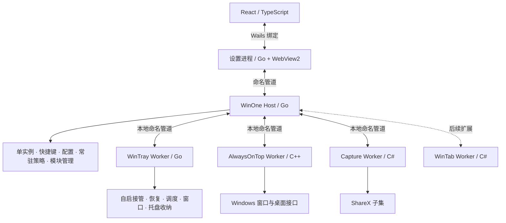

# WinOne 架构与开发计划

日期：2026-09-29。状态：**已批准实施，M0 验证进行中。**

## 1. 已确定的方向

WinOne 是 Windows 桌面聚合工具，首版完整覆盖截图、窗口置顶和现有 WinTray 功能，以后按模块增加工具。

- **Windows 11 优先**；首版建议 x64，Windows 10、ARM64 单独评估后加入。
- 主界面采用 React + WebView2，后台采用 Go/C++；复用模块保留所需运行时。
- 主界面对齐 Cindy 的近单色、扁平分区、细分隔线和柔和控件语言。
- 优先复用已有行为与测试，避免为了统一语言重写 WinTray 和 PowerToys 核心。
- 按阶段实施与验收；构建与测试状态见 `docs/development.md`。

## 2. 调研结论

| 参考 | 已核实事实 | 对 WinOne 的影响 |
| --- | --- | --- |
| PowerToys | AlwaysOnTop 使用 C++，包含窗口事件、边框、DPI、虚拟桌面、排除应用等处理；MIT | 复用相关实现及依赖，不能只复制一次置顶调用 |
| WinTray | Go 1.25、Walk/Win32；已有启动调度、恢复备份、托盘收纳及大量测试 | 保留 Go 核心，重做统一设置界面，保留必要原生消息循环 |
| Cindy | 桌面客户端采用 Electron；有独立设计规范，近单色、无基础阴影、胶囊按钮 | 借鉴设计语言，无需一起采用 Electron 或 AI 产品结构 |
| ShareX | GPL-3.0；有截图、图像编辑、滚动截图、贴图代码；开发分支正使用 .NET 10、WinForms/Avalonia 等依赖 | 首选截图候选，但必须先验证提取范围、运行时和发布依赖 |

**这些是源码与文档调研结果，不是已经完成的移植或兼容性测试。** 来源版本与检查范围见 [调研依据](调研依据.md)。

## 3. 技术选型

主路线确定为 **React + TypeScript + Vite / WebView2 + Go Host + 原生功能 Worker**。

| 层 | 选择 | 用途 |
| --- | --- | --- |
| 设置界面 | React、TypeScript、Vite | 页面、表单、模块设置、主题 |
| 界面宿主 | Wails v2 稳定版作为验证基线 | WebView2、资源加载、Go/JS 绑定、窗口与对话框 |
| 常驻后台 | 独立 Go Host | 托盘、快捷键、模块生命周期、管道通信 |
| Windows 功能 | Go / C++ | WinTray、置顶和系统操作 |
| 复用模块 | C# Worker | ShareX 截图、后续 WinTab；不要求重写成 Go/C++ |

### 3.1 宿主选择依据

| 方案 | 已核实能力 | 决策 |
| --- | --- | --- |
| **Wails v2** | Go/JS 绑定、事件、WebView2、原生对话框、单实例、用户数据目录配置 | **首选；以 v2.14.0 为本轮验证基线** |
| Wails v3 | 当前发布列表为 v3.0.0-beta.26 等预发布版本 | 不作为首版依赖；需要其能力时再评估 |
| 自建 Go + WebView2 宿主 | 可直接使用 go-webview2，但要自行维护绑定、资源、窗口与异常路径 | 仅在 Wails 明确无法通过关键验收时采用 |
| Tauri | Clash Verge Rev 已采用 React、独立核心和桌面能力 | 参考其模块边界；本项目保留 Go，暂不新增 Rust 宿主 |

Wails 仅用于设置窗口，不承担常驻后台。这样窗口退出、网页崩溃或框架升级不会直接停止自启管理与窗口增强。首版只需一个设置窗口，截图和贴图由对应 Worker 提供。

### 3.2 同类项目带来的具体调整

- **Clash Verge Rev**：参考 React 设置界面、独立核心进程及核心启停流程；后台状态由核心确认，界面不凭按钮点击推断成功。
- **Seelen UI**：参考网页界面与 Windows 桌面功能的分工；当前源码使用 Tauri，前端含 Preact/Svelte，作为系统集成参考，不当作 React + Go 的现成模板。
- **PowerToys**：沿用模块开关、独立设置和原生窗口行为的边界。
- **Cindy**：沿用视觉语言，以 React 组件和统一主题变量落地。
- **Microsoft WebView2 文档**：补入多进程计量、运行时部署、来源校验和崩溃恢复验收。

Go 以 WinTray 的版本为迁移起点；C++ 使用 MSVC 和 Windows SDK；C# Worker 单独锁定所需 .NET 版本。React、Vite 与 Wails 按验证通过的组合锁定，不追随开发分支升级。

## 4. 总体架构

采用**一个仓库、一个产品入口、按功能隔离的本地进程**。不引入服务器、微服务、远程插件市场或运行时任意 DLL 加载。



图中模块是职责边界，不要求全部始终运行。主窗口关闭后退出界面进程；Host 维持已启用功能；截图按需启动，无编辑器或贴图时退出；其他 Worker 仅在对应能力需要时驻留。

### 4.1 职责与所有权

| 部件 | 唯一负责的内容 | 不应承担 |
| --- | --- | --- |
| Host | 产品单实例、全局快捷键协调、主托盘入口、模块启停、全局设置、常驻判断 | 截图算法、自启迁移细节、置顶绘制 |
| UI | 页面、交互、输入校验、状态展示 | 直接修改注册表、计划任务、Worker 配置文件 |
| WinTray Worker | 程序管理、自启恢复、运行历史、窗口控制、托盘收纳与原生回调 | 新建第二个 WinOne 主托盘图标、管理全局快捷键 |
| AlwaysOnTop Worker | 置顶状态、边框、窗口事件、权限相关窗口操作 | 产品更新、程序启动管理 |
| Capture Worker | 截图、编辑、滚动捕获、剪贴板输出、贴图生命周期 | 上传、遥测、管理其他模块 |

同一配置或系统资源只允许一个写入者。Host 写全局配置；各 Worker 写自己的模块配置和恢复记录；UI 只通过命令修改。跨模块操作由 Host 协调，Worker 之间不互相引用代码或读写数据文件。

### 4.2 托盘整合

Host 维护唯一的 WinOne 主图标和静态菜单。WinTray Worker 提供收纳列表与菜单动作，原程序的右键菜单仍由 Worker 在自己的原生窗口线程调用。

图标跨进程传送像素数据或文件引用，不传可直接解引用的 HICON/HBITMAP。动作携带稳定 ID 和版本，执行前重新验证目标仍然存在。未收纳的程序图标保持原状；无原生图标的程序仍保留 WinTray 已有的托管入口行为。

这是迁移验证重点：Walk 消息循环、回调与菜单线程存在耦合。先保留隐藏的 Walk 消息循环，移除旧设置窗口和重复主托盘；以后有明确收益时才替换 Walk。

### 4.3 模块契约

首版仅加载随产品发布的可信模块。每个模块声明 ID、版本、协议版本、最低系统版本、命令、需要的权限和常驻条件。

统一生命周期：`Disabled → Starting → Ready → Stopping → Disabled`；失败进入 `Faulted`，显示原因和可重试动作。停止不等于直接杀进程，必须先恢复本模块改变的窗口与托盘状态。

统一命令分为三类：

- 查询：获取状态、设置、能力清单。
- 修改：保存设置、启动任务、设置置顶状态；带请求 ID 和设置修订号。
- 恢复：取消操作、停止模块、恢复受管资源。

统一结果区分成功、用户取消、不支持、权限不足、冲突、失败。禁止把“请求已收到”当作“操作已成功”。首版不承诺第三方插件 ABI 稳定，先通过新增一个内部模块验证扩展成本。

### 4.4 通信与恢复

使用 Windows 命名管道，UTF-8 JSON，长度前缀分帧，限制消息大小。请求包含协议版本、请求 ID、操作名和负载；事件包含会话代次与递增序号。断线重连先取完整快照与缓冲增量，按序号衔接，避免漏更新或旧事件覆盖新状态。

管道限本机，ACL 限当前用户及必要系统账户，并校验会话和对端进程。提权端还需校验受信任调用方、目标和具体动作；同用户 ACL 本身不是充分的提权授权。禁止提供任意 shell 执行接口。

截图图片不编码进 JSON；使用本次任务拥有的受限文件或共享内存句柄，明确创建者、读取者和释放时机。

普通请求建议 5 秒超时；截图、调度和授权操作使用任务 ID、进度与取消，不套用短超时。断线后查询任务状态；启动程序等有副作用命令不得自动盲重试。置顶使用“设为置顶/取消置顶”，不重放含糊的 toggle。

Host 监督 Worker，短期连续失败后停止重启并报告。Host 异常退出时 Worker 检测父进程消失，优先恢复资源后退出；重新启动时先恢复未完成记录，再接受新任务。不把用户的受管程序放入会随 Host 退出而终止的 Job Object。

### 4.5 权限与身份

默认普通权限运行，主 UI 不提权。管理员窗口操作或计划任务修改按需启动受限的提权模式；具体是短任务辅助进程还是长期置顶 Worker，由原型验证确定，不能让整套软件常驻管理员权限。

窗口与进程身份使用 HWND/PID 加进程创建时间及路径，操作前复核，防止句柄复用导致操作错对象。普通置顶、截图与 WinTray 的收起规则共享“受管操作状态”，截图选区和贴图窗口默认不参与自动收起。

### 4.6 WebView2 设置进程

用户启动 WinOne 后由 Host 判断是否已有设置窗口，存在则激活，否则启动 Desktop。开机后台模式不创建 WebView2。Desktop 的 Go 端只提供明确的页面 API，通过管道访问 Host；React 不直接连接 Worker。

关闭设置窗口时，先处理未保存表单，再退出 Desktop；不启用 `HideWindowOnClose` 保持网页进程常驻。Host 不随 Desktop 退出。重新打开时读取后台快照，恢复导航和窗口位置；临时表单不作为后台事实。

WebView2 有浏览器、渲染器、GPU 等子进程，资源预算按整组计量。关闭设置后验证本应用环境最终释放，不以窗口消失判断释放完成，也不能结束其他应用的 WebView2 进程。

后台快捷键可直接触发截图 Worker；不经过 React 或等待 WebView2 初始化。托盘菜单、UAC、原程序菜单和文件对话框使用原生路径。首版保留标准窗口边框；自定义标题栏只有在拖动、贴靠、最大化、DPI 与无障碍全部通过后替换。

### 4.7 前端边界与桥接

前端按 `features/capture`、`features/startup-tray`、`features/always-on-top` 拆分，WinTab 后续增加 `features/explorer-tabs`。每个功能导出页面、导航信息和设置表单；公共层仅包含控件、主题、桥接客户端与错误展示。

采用 React 路由、CSS 变量与可组合的无样式控件；表单状态留在页面，后台状态通过快照与事件更新。不将每个输入值、窗口句柄或高频鼠标事件放进全局 store。长列表在测量后按需虚拟化。

页面只调用领域命令，例如读取程序列表、保存某程序、开始截图、设置置顶、恢复标签组。Wails 绑定对象采用最小白名单，不把文件系统、注册表或任意命令执行能力整体暴露给网页。

Wails 生成的 TypeScript 类型负责 Desktop 桥接类型；跨进程协议以 `contracts/` 为准，双方验证输入及协议版本。事件在 React 卸载时取消订阅；连接重建时先订阅并缓冲事件，再取带序号快照，丢弃旧事件、补齐新事件，避免快照与订阅之间漏更新。

发布包只加载内置前端资源，不使用 Vite 开发服务。外链交给默认浏览器，阻止非白名单导航、弹窗与 iframe 调用原生桥接；部署 CSP，禁止页面执行远程脚本。用户路径、窗口标题、日志均按纯文本呈现。保留 WebView2 代码完整性检查。

WebView2 用户数据固定放在 `%LOCALAPPDATA%\WinOne\webview\`，不存放程序配置和恢复账本。默认使用 Evergreen Runtime；缺失时明确引导安装，离线环境提供说明。Fixed Version 仅作为确有离线需求时的独立发行选项，由产品维护其安全更新。

### 4.8 输入与窗口协调

Host 管理快捷键配置和冲突登记。普通全局快捷键由 Host 注册；WinTab 的资源管理器前台快捷键、滚轮、中键、双击与修饰键检测在 Worker 内执行，保留原生线程与时序。

不要把鼠标事件经 React/管道逐条转发。需要拦截输入的模块声明适用窗口和输入范围；截图选区活动时暂停冲突的手势处理，结束后恢复。验证按键按下/抬起、修饰键与前台切换，避免吞键或重复执行。

Host 记录资源操作的归属与目标代次；WinTab 合并/拖出 Explorer 窗口时发布失效通知，置顶模块复核旧 HWND 并清除对应边框，WinTray 不在此期间收起该窗口。新窗口不自动继承旧置顶状态，除非用户设置了明确规则。

## 5. 功能模块范围

### 5.1 截图：ShareX 为首选候选

比较结果：ShareX 功能最接近区域截图、编辑、滚动截图和贴图的组合；Greenshot 可作为较聚焦的捕获编辑备选；Flameshot 会引入 Qt，且本次尚未确认完整滚动截图和贴图需求，因此不作默认选择。三者均需按实际文件核对 GPL 条款。

**不把 ShareX 当成稳定 SDK。** 先验证其截图、编辑、滚动、贴图所需的依赖闭包，以稳定发布版本为起点；开发分支仅用于了解演进。无法合理拆出时，优先采用较完整的独立 Capture Worker，避免让 Host 或主 UI 引用整套 ShareX。

首版建议完整覆盖：

| 能力 | 验收行为 |
| --- | --- |
| 区域、窗口、全屏、多屏截图 | 混合缩放与负坐标屏幕中，选区和输出像素正确 |
| 标注 | 矩形、箭头、文字、画笔、遮挡、裁剪、撤销/重做正常 |
| 输出 | 复制与保存路径可选；保存失败可重试；取消不覆盖剪贴板 |
| 滚动截图 | 支持的窗口可停止、预览和重试；不支持时明确提示 |
| 贴图 | 移动、缩放、关闭与多屏切换正常，主设置窗口关闭后仍保留 |
| 快捷键 | 可修改，冲突明确提示，不强占系统截图快捷键 |

OCR、录屏、云上传和自动分享不属于本次首版范围。截图与贴图的外观在保留成熟行为的前提下统一；不承诺第一阶段重写整个编辑器。涉及受保护内容、独占全屏、HDR、远程桌面时按测试结果显示支持范围，不承诺所有画面均可捕获。

### 5.2 窗口置顶：PowerToys 行为基线

提取窗口置顶、取消置顶、窗口事件监听、边框跟随、DPI/圆角与虚拟桌面相关实现，保留 MIT 声明和上游版本记录。将 PowerToys 的设置、日志、启动器事件适配为 WinOne 服务，不带入其完整产品运行器。

首版包括快捷键、边框开关与样式、排除应用、多窗口、最小化恢复、跨屏、虚拟桌面、游戏/全屏保护及权限提示。透明度、系统菜单扩展等非用户明确要求的上游附加能力不自动纳入首版。

只恢复 WinOne 实际改变的状态；不能退出时取消其他软件或应用自身设置的置顶。已有置顶窗口的处理、外部程序同时修改状态、Worker 崩溃后的恢复必须单独测试。按第 9 节兼容性矩阵验收。

### 5.3 WinTray：全功能迁移清单

以下均属首版范围，不能用“已有程序列表”代替完成迁移。

| 功能 | 必须保留的行为 |
| --- | --- |
| 程序管理 | 添加、编辑、移除、暂停、立即启动、拖动排序、参数与路径校验 |
| 四种启动方式 | 收进托盘、后台启动、开机即启动、正常启动 |
| 脚本 | `.bat/.cmd/.ps1/.py/.pyw` 静默启动；保留原有模式限制 |
| 收起前等待 | 0–600 秒，从进程创建时间计算；登录窗口不被过早关闭 |
| 原生托盘 | 收起窗口后保留原程序托盘；失败或取消时恢复窗口 |
| 命令行托管 | 无原生图标程序可显示/隐藏窗口、结束托管、退出程序 |
| 托盘收纳 | 仅支持的 Windows 11 环境；图标、提示、单击与右键回调保持；取消与退出恢复 |
| 自启来源 | 登录任务、Run 注册表、启动文件夹快捷方式，保留参数、目录与权限 |
| 自启接管 | 避免双启动；暂停、切模式、移除、关闭自启可恢复原入口 |
| 无法识别原入口 | 明确报错，不猜测启动参数或静默换启动方式 |
| 延后启动 | 0–1440 分钟，默认 0 |
| 自动退出 | 0–1440 分钟，默认 30，0 不退出；保留子进程处理语义 |
| 自动运行频次 | 最近 1–365 天最多 1–1000 次；默认关闭，启用默认 1 天 1 次 |
| 频次语义 | 一天为 24 小时；重启/跨午夜不清零；手动启动不计入限制 |
| 错峰启动 | 默认 3 秒，0–120 秒；按排序执行，立即启动不受影响 |
| 常驻与退出 | 保留开机完成后退出、静默运行、再启动打开窗口的能力 |
| 设置与维护 | 语言、主程序自启、开机隐藏窗口、窗口等待、日志、更新检查与恢复/重置 |

功能清单基于当前 README、配置模型和关键流程；实施前补充菜单逐项走查，把未在 README 展开的交互纳入行为样本。

整合后的“开机任务完成后退出”受全局常驻条件约束：还有置顶快捷键、收纳图标、托管程序、自动退出计时、截图任务或贴图时，WinOne 继续运行。只启用 WinTray 且满足旧退出条件时保留自动退出。UI 明确显示阻止退出的功能，不能导入旧设置后让截图或置顶悄悄失效。

### 5.4 后续扩展：WinTab

WinTab 作为独立 C# Worker 接入，保留 Explorer 监听、COM/STA 调度、标签合并与复用、滚轮切换、双击关闭、中键打开、独立窗口例外、标签组和最近关闭标签恢复。

设置并入“资源管理器”页面，取消独立主托盘、自启和更新入口。配置与会话记录写入 `modules/wintab/`；从旧 `%APPDATA%\WinTab\session.json` 导入前备份，禁止两套程序同时管理 Explorer。模块启用时保持后台常驻。

当前代码依赖 .NET 9/WPF 的 Application 会话事件、SynchronizationContext、COM 与输入钩子。初期保留无主窗口的 WPF 生命周期，适配模块启停与设置；.NET 升级和移除 WPF 分别验证，不与功能接入混做。

WinTab 不加入首版交付范围，但 M0 使用“读取模块状态、恢复标签组”的契约样本检查扩展边界。后续实施需验收 Explorer 重启、关机恢复、前台快捷键、无效路径跳过、拖出窗口及与置顶/WinTray 并存。

## 6. 配置、迁移与故障恢复

数据建议写入 `%LOCALAPPDATA%\WinOne\`，程序目录不承担可变数据。首版建议便携目录发行，不要求单 EXE；WebView2 Runtime 检测、缺失时引导安装以及 C# Worker 的运行时打包均需在干净机器验证。

```text
WinOne/
  settings.json                 全局外观、快捷键、模块启用状态
  modules/wintray/               程序配置、历史、自启恢复记录
  modules/always-on-top/         置顶设置和必要恢复记录
  modules/capture/               截图设置
  recovery/                     跨模块迁移与更新事务记录
  logs/                         按模块滚动的日志
```

每份配置有 schemaVersion；写入采用同目录临时文件、校验和原子替换，并保留上一个有效版本。读取失败显示错误，不覆盖损坏文件。配置修订号用于拒绝过期界面的覆盖写入。

**WinTray 导入不能只复制 settings.json：**

1. 检测旧程序运行与原有自启任务，预览待导入项目；导入前不修改旧目录。
2. 备份配置、频次历史、自启恢复记录和任务标识。
3. 先停止旧版管理并由旧恢复流程归还原自启；核验成功后，再让 WinOne 接管。
4. 记录每项迁移状态；失败回退已完成步骤，保留可人工恢复的报告。
5. 防止两个版本同时管理同一程序。不要直接改名旧任务或删除旧恢复账本。

系统任务、注册表与文件无法构成一个原子事务，使用可重入的阶段记录与补偿操作。恢复前核对当前值仍归 WinOne 所有；发现用户或其他软件已修改时报告冲突，不盲目覆盖。

托盘收纳依赖 Shell 消息行为，系统更新、Explorer 重启、Worker 崩溃都可能破坏状态。首版必须有能力检测、重新枚举/恢复路径和可见的失败状态。无法保证正常工作时停止该能力，不把图标留在不可访问状态。

更新首版采用检查并提示下载，禁止运行中静默替换 Worker。整包版本一起验证和替换；更新前完成恢复与配置备份。以后增加自动更新时沿用停止、校验、替换、启动检查、回滚流程。签名、依赖许可证、对应源码和构建说明属于发布验收。

## 7. UI 方案

### 7.1 页面与操作

左侧固定导航：**概览、截图、窗口置顶、启动与托盘、设置**。后续模块新增导航项，不改动其他功能页面。概览只放常用入口和需要处理的问题，不做满屏统计卡片。

“启动与托盘”采用列表与详情面板，列表显示程序、启动方式、是否开机运行和当前状态；复杂时间设置展开后显示。开关操作反馈保存结果，失败保留原值并显示下一步。危险操作与普通保存分开。

托盘菜单提供截图、置顶操作、受管程序、打开 WinOne、退出。关闭窗口表示关闭设置进程；退出明确表示结束 WinOne，先完成窗口/图标恢复。截图选区直接出现，不先弹主窗口。

### 7.2 视觉基线

| 项目 | 建议规范 |
| --- | --- |
| 底色 | 浅色 `#F8F8F6`、深色 `#1F1F1E` |
| 弹层 | 浅色 `#FFFFFF`、深色 `#2C2C2A` |
| 分隔线 | 浅色 `#D7D7D4`、深色 `#3C3C3A`，关键控件边界另外校验对比度 |
| 字体 | 西文 Inter，中文回退 Microsoft YaHei UI；正文建议 14，辅助文字不低于 12 DIP |
| 层级 | 标题 20–24 DIP，正文 regular，标题 medium/semibold |
| 圆角 | 输入 8、面板 12、常规操作按钮胶囊；不做卡片套卡片 |
| 布局 | 同一底色，留白和细线分区；侧栏建议 208 DIP，内容边距 24 DIP |
| 状态 | 文字和图标说明；颜色仅用于焦点、警告、错误等语义 |
| 动效 | 150–200ms，尊重系统减少动画；无悬浮抬升和装饰动画 |

这些为 WinOne 初始建议值，不是 Cindy 的逐像素复刻。先完成“启动与托盘”一张代表页面的明暗原型，再把控件推广到其余页面。

窗口建议默认 1040×720 DIP；小屏可缩到 800×560 DIP，详情改为单页导航。适配 100%–200% 缩放及放大字体，内容可滚动，底部操作不能被裁切。保留系统窗口拖动、缩放、贴靠和键盘行为。

全程可用键盘；焦点可见；屏幕阅读器可识别开关、状态与快捷键。正文对比度目标 4.5:1，非文本关键控件目标 3:1；支持系统高对比度。权限不足、模块未安装、没有程序、任务失败都有单独状态，不能仅灰掉按钮而无解释。

视觉验收需覆盖主窗口、列表详情、空状态、错误态、菜单、截图工具条、贴图、置顶边框的浅色/深色与缩放效果；按代表页面与实际交互验收。

## 8. 建议目录与依赖规则

目标目录如下，实际跟踪边界见 `docs/repository.md`。

```text
apps/
  host/                         Go 产品入口与模块运行时
  desktop/                      Wails v2 设置宿主与 Go 管道客户端
    frontend/                   React / TypeScript / Vite
modules/
  wintray/                      Go 核心、适配层和行为测试
  always-on-top/                C++ 上游子集与 WinOne 适配
  capture/                      C# 上游子集与 WinOne 适配
contracts/                      管道协议、JSON Schema、兼容性样本
ui/                            React 控件、CSS 主题变量与视觉规范
third_party/                   上游版本、许可证、补丁说明
tests/                         契约、跨模块和真实 Windows 验收
build/                         统一构建、打包和依赖锁定
docs/                          架构、决策、开发与恢复说明
```

依赖只能指向契约和明确的公共服务；禁止模块互相引用内部目录。上游代码与本产品适配层分开，记录每个补丁用途，升级时可对比。Go `internal` 可见性按实际 go.mod 根设计，不能直接跨模块导入 WinTray 的 internal 包。

新增模块只需声明命令/能力、实现生命周期、注册页面与菜单、提供测试和发布依赖；不必修改现有截图或 WinTray 核心。真正重复的逻辑出现后再抽共享库，不提前建立万能工具包、通用工作流引擎或插件市场。

## 9. 开发顺序与验收

以下是依赖顺序，不是已经完成的工作。工期是单名熟悉 Windows 桌面开发者的粗估，不含等待签名、用户试用和外部审批；M0 后重新估算。

| 阶段 | 工作与交付 | 依赖 | 退出条件 | 粗估 |
| --- | --- | --- | --- | --- |
| M0 风险验证 | React/Wails 设置原型与独立 Host；WebView2 部署/退出/崩溃验证；ShareX 捕获/编辑/滚动/贴图；PowerToys 独立置顶；WinTray 菜单通信 | 已获实施授权 | 在真实 Win11 验证可构建、可启动、可恢复；锁定依赖/许可证；失败项有明确技术决策 | 1–2 周 |
| M1 产品底座 | Host、UI、模块协议、单实例、统一快捷键、设置与日志、错误状态 | M0 | UI 关闭不停止功能；模块断线重连；快捷键冲突可处理；故障不伪装成功 | 1–2 周 |
| M2 WinTray 迁移 | 迁移核心和测试；程序管理 UI；原生菜单整合；配置导入与回退 | M1 | 第 5.3 节逐项通过；与旧版相同样本对照；无双启动、无丢失恢复记录 | 2–4 周 |
| M3 置顶 | 适配上游核心、设置页、权限模式、窗口身份与状态恢复 | M1 | 普通/管理员、跨屏、桌面切换、最小化、退出/崩溃恢复通过 | 1–2 周 |
| M4 截图 | 完成独立 Worker、编辑与输出、滚动与贴图、主题和快捷键整合 | M0、M1 | 第 5.1 节完整验收；关闭 UI 后贴图仍在；无后台上传；取消释放资源 | 2–4 周 |
| M5 联调与发布候选 | UI 全面走查、全局退出策略、兼容性、长时运行、打包与回滚 | M2、M3、M4 | 功能矩阵、故障恢复、干净机器安装运行、许可证与源码包全部通过 | 2–3 周 |

串行粗估 **9–17 周**。M2/M3/M4 在协议稳定后可以由不同开发者并行，但不能通过删掉滚动截图、贴图或 WinTray 难点来缩短“完整首版”的定义。

M0 的重要决策：ShareX 若稳定版提取成本过高，比较保留较完整 Worker 与 Greenshot 的缺失能力成本后再决定；WebView2 宿主或原生菜单桥接失败时先修正对应边界，不立即推翻整个产品架构。

### 9.1 测试分工

M0 按以下验证包执行，每项保留源码版本、构建方式、测试环境、结果与决定；通过前不扩大到完整功能开发。

| 验证包 | 实际操作 | 通过条件 | 不通过时 |
| --- | --- | --- | --- |
| V1 宿主链路 | React → Wails Go → 命名管道 → Host，完成查询、修改与错误返回 | 类型一致；无重复执行；超时后状态可查询 | 修正桥接契约；只有框架限制才评估底层宿主 |
| V2 窗口生命周期 | 连续打开/关闭 30 次；杀掉本应用设置进程；后台继续响应 | 唯一设置窗口、无持续残留进程/句柄，托盘和 Worker 不停 | 修正 Desktop 与 Host 的父子关系和退出路径 |
| V3 WebView 故障 | 在专用测试环境模拟渲染器失败、只读数据目录、缺运行时、离线启动 | 原生错误入口可用；不会反复自动重启；后台保持可控 | 完善原生失败页和运行时检测 |
| V4 Windows 交互 | 中文 IME、Tab/Enter/Esc、屏幕阅读器、文件拖入、贴靠、跨 DPI、主题切换 | 设置可操作、文本不裁切、焦点不丢失、拖入文件不导航走 | 优先使用标准窗口与原生对话框 |
| V5 原生整合 | WinTray 菜单回调；置顶时截图；WinTab 窗口替换样本 | 无错误 HWND 操作、无吞键、失败可恢复 | 修正模块操作归属和输入暂停策略 |
| V6 发布依赖 | 干净 Win11 安装/解压运行；路径含空格与中文；标准用户启动 | 无开发工具依赖；Runtime 缺失有明确处理；卸载/退出可恢复 | 调整运行时与安装策略 |

设置窗口冷启动与热启动分别计时。统计整个 Desktop/WebView2 进程组和后台 Worker 的内存、CPU、句柄；UI 关闭 30 秒后复测。M0 形成实测基线后再确定资源上限。

- Go：保留 WinTray 相关测试，在新的模块目录执行 `go test ./...`、`go vet ./...` 和 Windows 构建；具有系统副作用的测试在专用环境运行。
- React：类型检查、表单与错误状态测试、浏览器页面测试；另在打包后的 WebView2 中验证窗口、IME、拖放、键盘和 Go 绑定。
- C#：配置/契约与截图结果测试；真实桌面验证捕获、权限和 WinTab 行为。
- C++：置顶状态、窗口标识和依赖适配测试；真实窗口验证边框、缩放与事件顺序。
- 跨模块：开关模块、Host/Worker 异常退出、协议不兼容、设置并发保存、任务中关闭 UI、升级回退。

具体测试命令在对应构建项目确定后固化到统一 Windows 脚本。现阶段不提供不存在的项目命令并声称可运行。

### 9.2 发布候选必须通过的矩阵

| 维度 | 必测场景 |
| --- | --- |
| 系统 | 选定最低支持的 Win11 build、发布时仍受支持的当前 Win11 版本；具体 build 随 M0 记录 |
| 显示 | 单屏/双屏、100/125/150/200%、不同缩放、负坐标、插拔、HDR 开关 |
| 权限 | 普通用户、管理员目标、取消 UAC、权限拒绝、受保护窗口 |
| 会话 | 登录、锁屏/解锁、睡眠/恢复、Explorer 重启、远程桌面 |
| 生命周期 | UI 退出、正常退出、强制结束 Worker/Host、系统关机与重启 |
| 程序类型 | Win32、WinUI/UWP 类窗口、Electron、命令行、脚本、启动器与多进程应用 |
| 配置 | 旧配置、损坏文件、磁盘写失败、部分迁移、用户中途修改原自启 |
| 并存 | 已运行 PowerToys/截图工具、快捷键冲突、旧 WinTray 正在管理 |

发布门槛：不存在已知的数据丢失、误杀进程、原自启不可恢复、窗口/图标无法找回问题；所有首版行为有验收记录。长时运行至少 24 小时，循环截图/置顶/收纳 100 次后无持续增长的句柄或内存趋势。

性能目标先作为预算验证：无任务后台 CPU 平均低于 0.5%，设置热启动 P95 小于 500ms，截图热启动到选区 P95 小于 300ms；使用固定测试机、Release 构建、至少 30 次样本并记录。内存与包体在 M0 测量各进程基线后制定上限，不能以未测数据宣传轻量。

## 10. 维护与交付约定

WinOne 按适用 GPLv3 要求开源发布，精确 SPDX 标识在依赖锁定时确定。保留 WinTray/PowerToys 的 MIT 声明；引用 Cindy 代码或资产时另核对 Apache-2.0/NOTICE 与资产许可。

每次发布附上对应源代码、构建说明、依赖版本与许可证清单。WinOne 自有名称与图标独立设计，不使用 Cindy/PowerToys 品牌素材作为自身标识。

稳定期按模块升级上游，一次只推进一个高风险来源；更新后重复该模块与跨模块恢复测试。兼容性问题记录 Windows build、应用版本、复现条件与恢复结果，避免以“支持 Windows 11”掩盖具体限制。

**当前正在执行 M0 风险验证，完成后按依赖推进 M1–M5。**
