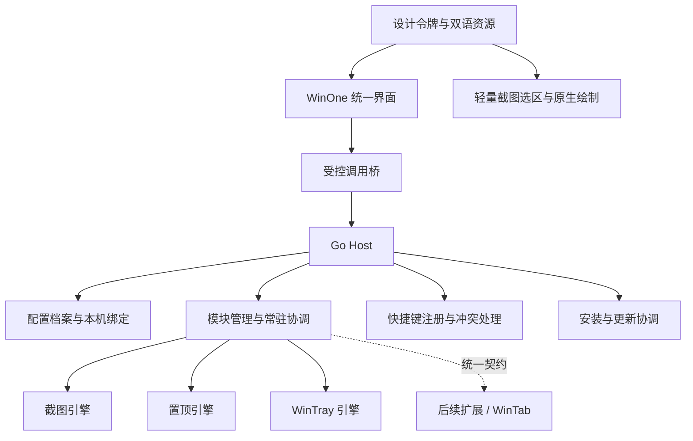

# WinOne 架构与开发计划

更新：2026-10-02。状态：**截图及新增模块采用统一原生控件，性能优先；置顶和程序管理保持现状，整体尚未完成。**

## 1. 产品约束

WinOne 是一个 Windows 通用工具集。模块提供能力，WinOne 提供统一的设置、操作与体验。

- **默认基础模块：截图、窗口置顶、启动与托盘（WinTray 全功能）。** 三者随安装包提供，均可单独关闭。
- 后续扩展支持按需下载、离线加载、启用、禁用、更新和卸载；不为每个扩展另造一套管理方式。
- 主界面、截图工具栏、编辑器、滚动预览、贴图菜单及模块设置遵循同一设计系统。
- 首版 Windows 11 x64；中英双语与离线基础功能进入首个完整版本。Windows 10、ARM64 独立验证后加入。
- 配置可在公司和家里迁移；本机程序位置与系统恢复记录不直接复制到另一台电脑。
- 功能增加必须有资源预算。只验证后台算法或能启动独立窗口，不等于完成产品接入。

核心约定同时写入根目录 `AGENTS.md`。设计依据见 [统一体验与设计依据](统一体验与设计依据.md)，协议边界见 [模块与配置契约](模块与配置契约.md)。

## 2. 技术与复用边界

保留 **现有设置界面 + Go Host + 原生功能适配器**。截图操作界面及后续新增模块采用成熟原生控件与 WinOne 统一风格，性能优先。置顶功能和程序管理的现有界面、实现及共享设置壳保持现状，不安排原生化迁移。新增原生模块按需复用控件与运行时，其选型仍须经过同负载性能和完整交互验证。

| 层 | 职责 |
| --- | --- |
| WinOne UI | 保留现有导航和设置壳；截图及新增原生界面复用统一风格、控件与状态反馈 |
| Host | 模块管理、快捷键、配置事务、唯一主托盘、常驻决策、更新协调 |
| 功能引擎 | 截图与拼接、置顶与边框、程序启动与托盘收纳等系统能力 |
| 平台适配层 | Windows 窗口、DPI、原生对话框、权限、文件与设备能力 |
| 包与更新服务 | 清单校验、依赖解析、安装/卸载、版本切换、回滚 |

已有 Go/C++/C# 引擎和有效测试继续使用。**不能把上游完整应用、原设置页或原编辑器直接作为 WinOne 的最终界面。** 原生文件选择、UAC 和 Windows 系统菜单仍保留系统行为。

选型对照包括已锁定ShareX的WinForms实现，以及[PowerToys设置界面的WinUI工程](https://github.com/microsoft/PowerToys/blob/main/src/settings-ui/Settings.UI/PowerToys.Settings.csproj)（2026-10-02核对`UseWinUI=true`）。只借鉴成熟实现与组件行为，不把项目名当作性能证据；最终选择由同负载数据与完整交互共同决定。

进程隔离用于故障和生命周期管理，**不宣称它是恶意代码沙箱**。首轮扩展只接受项目审核、签名的模块；本地开发模块使用明确的开发模式。

## 3. 模块管理

### 3.1 默认模块与扩展

基础模块与扩展使用相同清单、版本和生命周期契约。基础模块默认安装，首版提供开启/关闭与修复安装；扩展模块提供安装、离线导入与卸载。

模块清单声明：稳定 ID、版本、Host/协议兼容范围、平台、运行时依赖、能力、设置版本、界面入口、语言资源与启动策略。安装状态和运行状态分别保存。

| 用户状态 | 实际行为 |
| --- | --- |
| 未安装 | 不加载界面代码或引擎；保留导入的设置可供日后使用 |
| 已关闭 | 不注册快捷键，不启动 Worker，不执行定时任务；保留设置 |
| 已开启、待使用 | 可被调用，引擎按需启动 |
| 正在使用 | 保留完成当前任务所需的进程和资源 |
| 需要处理 | 显示原因和下一步，不把失败显示为已开启/已关闭 |

安装过程：下载或选择本地包 → 校验签名与内容 → 检查兼容/依赖 → 暂存解包 → 原子登记。校验完成前不执行包内代码。

禁用过程：停止接收新任务 → 释放快捷键 → 完成或由用户取消当前任务 → 归还本模块控制的资源 → 停止引擎 → 持久化关闭状态。恢复失败时保留故障状态和恢复入口，不强行显示“已关闭”。

卸载过程：先完成禁用，再移除模块文件；默认保留设置。共享运行时按引用计数保留，不删除其他模块需要的文件。

### 3.2 启动与常驻

- Host 是唯一产品托盘与协调入口，不包含 WebView2。
- 置顶和程序管理继续复用现有设置宿主；新增原生界面按需加载。关闭窗口后释放无任务的界面资源，不为每个模块保留独立隐藏宿主。
- 截图引擎按需启动；编辑/贴图结束后按空闲策略退出。
- 置顶仅在快捷键调用或存在置顶窗口时需要引擎；关闭模块时撤销归属明确的置顶。
- WinTray 根据启用的启动、托盘与定时能力决定常驻；空配置不应长期占用完整 Worker。
- 模块设置提交时更新常驻声明；Host 不自行解释每个引擎的私有配置。声明过期或恢复未完成时先核验，不能据此误退出。
- 更新、禁用、卸载与权限切换使用统一任务状态和互斥规则。

### 3.3 快捷键

快捷键由 Host 注册，配置入口放在对应模块。截图支持按动作配置，先展示区域截图；窗口置顶提供切换快捷键。WinTray 不增加无用途的全局快捷键。

录入时检测本产品重复组合、系统保留组合及系统注册失败。冲突提示关联具体操作，保留原绑定供用户修改；禁用模块立即释放其绑定。配置导入只恢复意图，必须在本机重新注册并显示结果。

## 4. 配置档案与跨设备使用

统一配置中心提供“导出配置”“导入配置”和档案选择。首轮实现可靠的手动迁移；同步文件夹是后续可选能力，不自动连接云账户。

| 配置类别 | 迁移策略 |
| --- | --- |
| 主题、语言、导航偏好、快捷键、模块设置 | 可导出；按 schema 迁移并预览差异 |
| 程序路径、工作目录、截图目录 | 使用路径占位与设备映射；无法匹配时提供选择入口 |
| 未安装模块的设置 | 保留，标为待安装，不自动执行或丢弃 |
| PID、HWND、缓存、日志、运行中任务 | 不导出 |
| 注册表/计划任务备份、系统资源归属账本 | 仅属于原设备，不跨设备复用 |
| 凭据等敏感字段 | 默认不导出；以后有明确需求时采用成熟加密方案 |
| 启动频次历史 | 默认按设备维护；迁移旧 WinTray 时可单独合并，不作为普通偏好同步 |

标准用户目录通过 Windows Known Folders 解析，不依赖固定用户名和盘符。普通用户只需看到“程序位置需要重新选择”等具体提示；别名与批量映射放二级页面。

导入流程：选择文件 → 校验 → 预览新增/修改/冲突 → 处理缺失程序或模块 → 应用。导入本身不启动程序、不执行脚本，也不下载扩展。涉及本机自启的改变单独列入应用预览。

配置文件与系统状态无法共用一个数据库事务：先记录事务，再逐步应用；失败补偿或保留明确的待恢复状态。已有 WinTray 的系统任务交接必须先归还旧版管理的资源，不能只复制设置和历史。

## 5. 统一界面

### 5.1 信息结构

一级导航：**首页、截图、窗口置顶、启动与托盘、模块、设置**。后续扩展默认进入模块页和可固定的快捷入口，不无限增长侧栏。

| 页面 | 第一层 | 第二层 |
| --- | --- | --- |
| 首页 | 常用动作、最近使用、当前需处理事项 | 自定义快捷入口 |
| 截图 | 区域截图、最近结果、截图快捷键 | 其他截图方式、输出、滚动选项 |
| 窗口置顶 | 模块开关、快捷键、已置顶窗口 | 边框、排除应用、权限 |
| 启动与托盘 | 程序列表、添加程序、常用启动方式 | 单程序参数、收纳、定时、频次、自启接管与恢复 |
| 模块 | 已安装/可安装、开启/关闭、安装进度 | 依赖、版本、权限、卸载 |
| 设置 | 外观与语言、配置导入导出 | 更新、存储、日志与诊断、关于 |

所有 WinTray 功能都必须能在对应面板完成设置，不能要求用户打开旧 WinTray。低频功能可以进入二级页面，但不能因此遗漏。

### 5.2 原生组件与离线资源

- 截图及新增原生模块复用 WinOne 原生控件库；置顶、程序管理保持现有控件。各界面统一颜色、字体、间距、焦点、主题、语言及错误反馈，选型优先验证性能。
- 新增模块的简单设置可由原生宿主按声明式配置呈现；特殊工作流由审核后的原生入口承载，继续使用共享组件，不引入独立产品设置或托盘。现有两模块的设置面板不重写。
- shadcn-admin、Fluent 等优秀界面仍可用于研究布局与任务组织，不再作为模块运行时依赖或代码选型约束。
- 图标复用已锁定的 Lucide 本地资源，按 DPI 提供相应尺寸；字体优先系统字体。运行基础功能不依赖浏览器、CDN、在线字体或组件网站。
- 原生运行时集中分发并按依赖共享，避免每个模块携带一整套运行时；新增控件库和运行时须记录许可证、包体及资源增量。

### 5.3 截图体验重做

最终流程：**触发截图 → 同一窗口选择、调整并编辑 → 确认复制或保存**。双击确认并复制，右键取消；不切换到另一个编辑窗口，不提供多余的预览步骤。

原生画布、工具栏与图上文字输入共用 WinOne 风格、图标和快捷键表达。默认窗口识别，拖动可选区域；四边和角点可调整。工具栏最多两行，常规操作与编辑工具分开，支持握柄拖动和自定义显示项，所有操作保持可访问。

保留 `CapturedFrame` 的原图、物理像素、负坐标与独立裁切所有权约定。缓冲、绘制层、历史和文本排版必须共同验证，不能只证明某个渲染入口正确。文字直接输入在截图上，取消不改原内容，提交只产生必要的历史记录；连续马赛克、模糊、窗口内部检测、滚动截图、贴图、重截及恢复按既定清单完成。

当前原生原型已验证部分工具栏、文字、历史与输出流程，尚未成为产品。完整状态以[截图单界面重构](截图单界面重构.md)和[开发状态](development.md)为准；旧网页、双窗口交接和预览工作流不作为目标实现。

## 6. 双语、错误与状态

简体中文和英文从设计系统阶段建立。界面字符串、菜单、快捷键帮助、安装器和更新提示使用语言资源；不在每个模块里另写一套语言开关。

业务错误返回稳定错误码与参数，界面负责翻译。原始系统错误、路径和技术细节放“查看详情”。模块需同时提供中文与英文资源；缺键、长文本、复数和缩放进入 CI 与视觉验收。

简单开关即时应用并显示处理中/失败恢复；多字段修改采用明确保存与取消。失败保留输入，不显示成功提示，不让用户猜操作是否生效。

## 7. 安装、更新与扩展分发

首个完整版本提供 **每用户安装器 + 便携包**。默认安装三个基础模块；安装器负责实际原生运行时检测、路径、卸载和必要的恢复入口。迁移期间保留旧测试包仍需要的依赖，不提前移除。

安装器以 Wails 官方 NSIS 路线为基础，按 WinOne 的多组件清单生成文件列表。日常运行保持普通权限，特定操作才请求提升；不把整个产品常驻为管理员。

截图操作及新增原生模块不依赖 WebView2；保留的现有设置界面继续使用它。C# 引擎不要求用户安装开发 SDK；多个 .NET 模块共用经过版本验证的运行时分发包，避免重复携带。联网与离线安装资源分开提供；按实际保留界面核验依赖，现阶段不移除WebView2运行时检测。

检查更新和应用更新分开：

1. 首个完整版本提供手动检查、版本/变更说明、兼容性与下载入口。离线时正常使用。
2. 更新应用通过独立短命更新程序完成：停止新任务 → 用户完成当前操作 → 恢复资源 → 校验新包 → 切换版本 → 启动确认 → 失败回滚。
3. 扩展模块沿用同一套校验、兼容和恢复机制。模块包需签名、大小限制、完整性校验和防路径穿越；仅有 SHA-256 不等于验证发布者身份。
4. 自动更新、渠道切换和第三方模块放后续阶段；更新元数据设计参考 TUF，不自行宣称简化协议具备完整防回滚/防冻结保障。

尚未授权对外建仓、推送或发布。代码签名身份、发行渠道和企业分发条件在发布阶段落实，不用未签名测试包冒充正式安装包。

## 8. 资源预算与测量

性能是选型与实施顺序的首要门槛。以下是**项目初始预算，不是已测结果**；P0 必须记录硬件、系统、Release 版本和真实基线。超预算先优化边界和生命周期，不能默默提高指标。

| 场景 | 初始目标 |
| --- | --- |
| 仅 Host、全部模块关闭 | Worker/WebView2 为零；CPU 平均低于 0.2%；私有工作集目标不高于 40 MiB |
| 三模块开启但没有任务 | 未使用的截图/置顶引擎休眠；WinTray 仅保留实际需要的常驻能力 |
| 主窗口关闭 | 15 秒内释放无任务的界面宿主与辅助进程；进行中的编辑另计 |
| 截图首次选区 | 冷启动 P95 目标不高于 800ms；热启动不高于 300ms |
| 模块关闭/卸载 | 快捷键释放；无恢复任务时 5 秒内完成资源回收 |
| 循环使用 | 100 次截图/置顶/托盘操作后，无持续增长的私有内存、GDI 和句柄趋势 |

总量统计包含 Host、现有设置宿主、原生界面、所有 Worker 及运行时辅助进程；迁移期也计入仍存在的 WebView2 进程。分别报告私有工作集、Private Bytes、CPU、句柄、GDI、冷/热启动、包体和磁盘占用，不能只看主进程。

“聚合应更轻”的对照：在同机、同等功能与负载下，比较 WinOne 全进程组和三个独立工具的总成本，不用启动整个 PowerToys 套件制造不公平基线。目标是稳态资源不高于独立工具总和；每新增模块都报告禁用、启用空闲和执行任务三种增量。

大图采用按需绘制、受控缓存和显式释放；不要在管道内反复传输整张图片的 Base64。无任务时不轮询界面、不后台联网拉组件。性能结论必须附数据。

## 9. 路线图：想三步做一步

每阶段开工前明确当前切片和后两步依赖；阶段结束后重新审视后三步。整体边界稳定，具体实现随着证据调整，不按临时修补顺序驱动产品。

| 阶段 | 交付内容 | 门槛 |
| --- | --- | --- |
| P0 产品与预算基线 | 本架构、功能清单、设计系统原型、资源基线、截图 UI 技术样机 | 来源可追溯；常用路径清楚；性能方案有实测 |
| P1 统一底座 | 模块清单/开关/生命周期、统一配置中心、错误协议、中英资源、组件与导航 | 三基础模块都可独立关闭；关闭后无残留动作；离线 UI 可用 |
| P2 跨设备配置 | 配置导出导入、设备映射、差异预览、兼容迁移与恢复 | 公司/家里路径不同可处理；缺模块不丢设置；导入不隐式执行 |
| P3 三模块统一体验 | WinTray 全功能面板、置顶面板、全新截图工具栏/编辑器/滚动预览 | 没有依赖上游设置界面的用户流程；全部能力有 UI 路径与验证 |
| P4 分发能力 | 每用户安装器、便携包、检查更新、签名模块包安装/离线加载/卸载 | 干净机器可用；失败可恢复；共享依赖不会误删 |
| P5 完整版验收 | 资源对照、跨模块故障、多屏/DPI、双语、新用户任务验证、文档 | 无已知数据丢失、资源归还失败、误启动或假成功；发布材料齐全 |
| P6 后续扩展 | WinTab、Cedro Modern Dock、PecoFence 等模块、按需下载目录、可选同步与自动更新 | 用既有 SDK/包/配置/UI 契约接入，不重新改造 Host |

**接下来三步：**

1. **截图完整闭环**：继续完成原生截图的完整工具集、主题、双语、DPI、IME、重截和恢复；分别测量进程启动、首帧、输入可用、任务完成及资源回收，既定预算不放宽。
2. **保留现有模块，准备新增模块契约**：置顶功能、程序管理和现有设置壳保持现状，不安排原生化重写；新增模块使用共享原生控件与运行时，先做同负载性能和代表任务验证，再扩大实现。
3. **统一交付与扩展契约**：将新增模块的声明式设置、原生操作入口、共享运行时和版本兼容纳入包契约；完成安装更新、卸载恢复、资源对照和新用户任务验收。随后滚动推进跨设备、长期稳定性与WinTab等扩展，不缩减原目标。

P3/P4 的接口在 P1 定义，界面和安装更新不会等到最后临时补入。新增需求先定位到路线图和契约，再安排实现。

### 9.1 后续扩展候选（已登记接入意向）

以下三项为已登记的接入意向，排在 P4 包契约之后；开工前先按第 2 条要求提交可行性、性能与系统恢复方案，不先写实现。

- **WinTab**：本地 `../WinTab`，HEAD `6b6112e8`，v2.3.0（2026-10-02）。Windows 11 资源管理器标签工具，net9.0-windows / WPF，MIT。能力：窗口合并为标签、复用已有标签、标签组与最近关闭标签恢复、标签栏滚轮切换、保留独立窗口的例外与拖出成窗。
- **Cedro Modern Dock**：`https://github.com/Cedro-Software/cedro-modern-dock`，v1.2（2026-08-16）。桌面应用 Dock，.NET 9 + Avalonia 11.3，GPL-3.0。能力：应用快捷方式、运行中窗口实时预览并前置、未固定程序入坞、图标着色、拖拽排序、垂直 Dock、含简体中文界面。
- **PecoFence**：`https://github.com/DayuanJiang/PecoFence`，v0.1.3（2026-09-30）。Windows 11 桌面栅栏（Stardock Fences 替代），Rust 原生程序 + WebView2 设置界面，Apache-2.0。能力：玻璃面板收纳桌面图标、活动文件夹、标签页、Peek 预览、便携包、含简体中文的 10 种语言，并提供内置 CLI 供外部配置布局、外观与排序规则。

共同约束：

- 三项都按 P4 的可选模块包契约接入（清单、签名、安装/卸载与恢复），复用共享原生控件与运行时，不改造 Host。
- WinTab 改写资源管理器窗口状态（合并窗口、保存标签组、接管会话结束），禁用与卸载必须完整恢复窗口状态、快捷键和托盘资源，不用延时、临时置顶或重复显隐掩盖问题。
- Cedro Modern Dock 与 PecoFence 都常驻桌面层，且都要参与桌面图标与窗口层级的处理；接入前先确定两者的共存与互斥规则，不允许同时改写桌面图标布局。Dock 的“程序快速访问”与 WinTray 收纳职责重叠，需先定归属，避免出现两处入口。
- PecoFence 自带 WebView2 设置界面和 CLI 配置入口，都不作为 WinOne 的最终产品界面：配置项与语言并入统一设置与双语资源，CLI 只保留为自动化接口，不新增常驻进程；其 WebView2 进程计入资源增量测量。
- 各模块界面栈不同（WPF / Avalonia / Rust + WebView2），一律按独立 Worker 与统一契约接入，不把上游 UI 运行时并入共享原生宿主。
- 许可证核对后随模块补齐 `THIRD-PARTY-NOTICES.md` 与 `third_party/sources.json` 记录（MIT / GPL-3.0 / Apache-2.0）。核验依据见[调研依据](调研依据.md)。

## 10. 当前实现如何对齐

已有三模块引擎、权限切换、持久化和部分原生测试可复用，但当前仍存在明确缺口：

- 三个基础模块的总开关、按需启动和统一设置已接入；可选模块包管理与共享依赖管理仍未完成。
- 跨设备配置导入导出、中英资源和安装器已有实现与局部验证；产品检查更新入口、旧配置迁移和完整跨设备任务仍未完成。
- WinTray 已迁入程序列表及分区设置；截图已采用统一工具栏与画布。完整用户任务、边缘交互和恢复流程仍在打磨。
- 置顶和程序管理保留现有shadcn/ui界面。原生截图仅有局部验证；新增原生模块契约、新用户任务及完整资源验收仍未完成。
- 部分原生用例有环境差异或间歇失败，不能以已通过的局部测试覆盖整体结论。

现阶段应先完成统一底座和规划中的代表切片，再扩展实现。历史引擎测试是回归依据，**不是统一产品体验的验收结论**。

## 11. 基础功能清单与验收边界

统一 UI 改造不能减少既定能力。每一项都要建立 UI 路径、实际结果和失败恢复证据。

| 截图能力 | 验收要求 |
| --- | --- |
| 区域、窗口、全屏、多屏 | 选区、混合缩放、负坐标与输出像素正确 |
| 矩形、箭头、文字、画笔、遮挡、裁剪 | 中文输入、撤销/重做、缩放后编辑与导出一致 |
| 复制与保存 | 路径可选；失败可重试；取消不覆盖剪贴板；已保存结果不丢失 |
| 滚动截图 | 可停止、预览和重试；不支持或仅部分完成时准确提示 |
| 贴图 | 移动、缩放、关闭、多屏；设置窗口关闭后仍可用 |
| 快捷键 | 按动作配置、冲突提示、不强占系统组合 |

OCR、录屏和云上传可作为后续独立扩展，不并入当前截图基础包。

| 置顶能力 | 验收要求 |
| --- | --- |
| 多窗口置顶与取消 | 核验实际状态；不接管其他软件已有置顶 |
| 边框与排除 | 边框开关、样式、圆角、跟随及程序排除 |
| Windows 场景 | 最小化恢复、跨屏、虚拟桌面、游戏/全屏保护 |
| 权限与恢复 | 普通/管理员、取消 UAC、正常退出与崩溃恢复 |

| WinTray 能力 | 验收要求 |
| --- | --- |
| 程序管理 | 增删改、暂停、立即启动、排序、参数与路径校验 |
| 四种启动方式 | 收进托盘、后台启动、开机即启动、正常启动 |
| 脚本 | bat/cmd/ps1/py/pyw 静默启动及原有模式限制 |
| 收起前等待 | 0–600 秒，按进程创建时间计算，不提前关闭登录窗口 |
| 原生托盘与命令行托管 | 原图标保留；无图标窗口可显示/隐藏、结束托管和退出程序 |
| 图标收纳 | 图标、提示、动态更新、单击/右键、拖动兼容、退出恢复 |
| 自启接管 | 任务、Run、快捷方式的参数/目录/权限保留；避免双启动；移除或切模式可恢复 |
| 不可识别入口 | 明确指出问题，不猜参数或静默换模式 |
| 定时 | 延后启动 0–1440 分钟；自动退出 0–1440 分钟，默认 30，0 表示不退出 |
| 自动运行频次 | 最近 1–365 天最多 1–1000 次；默认关闭，启用默认 1 天 1 次；手动启动不计入 |
| 错峰启动 | 默认 3 秒、0–120 秒；按排序执行；立即启动不受影响 |
| 常驻与维护 | 完成后退出、静默运行、再启动打开窗口、恢复/重置；语言、日志和更新统一到产品入口 |

频次中的一天为 24 小时，跨午夜或重启不清零。定时退出保留子进程与实例身份保护。原有功能的逐项菜单走查仍需补齐，不能只对照 README。

完整版本还需覆盖：选定最低与当前支持的 Win11 版本；单/双屏、100/125/150/200% 缩放、HDR、负坐标与插拔；锁屏/睡眠/远程桌面；Explorer 与 Host/Worker 重启；损坏配置、写入失败和外部改动；干净机器安装、离线运行、更新失败与卸载恢复。

至少进行 24 小时稳定性观察和 100 次操作循环，检查资源趋势。真实新用户任务、权限与硬件场景未验证时必须标明，不能由单元测试推断已经通过。
