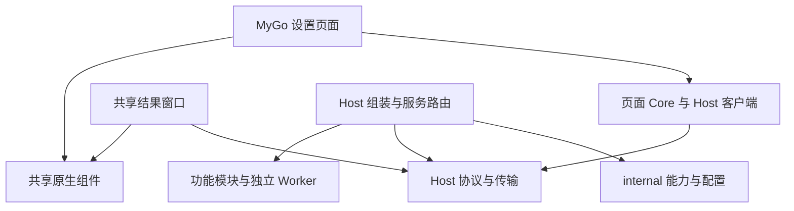

# 工程导航与协作边界

WinOne 由后台统一管理配置、模块和任务。设置窗口、结果窗口与截图模块通过已有协议调用能力；新增功能先定位所属入口，不再建立另一套配置或结果窗口。

## 修改入口

| 工作范围 | 主要实现 | 相关契约与验证入口 |
| --- | --- | --- |
| 后台组装、启动与关闭 | `apps/host/` | `build/test-source.ps1`；进程专项 `build/test-process-lifetime.ps1` |
| AI 配置、凭据、模型目录 | `internal/ai/` | `build/test-capture-followup.ps1 -Suite ocr -Filter <用例>`；性能 `build/benchmark-ai-catalog.ps1` |
| AI 请求与结果任务 | `apps/host/ai_jobs_windows.go` | 同一 OCR/Host 入口；等待、取消、所属窗口与增量读取测试在 `apps/host/ai_*test.go` |
| AI 供应商与账号执行 | `modules/ai-magpie/` | `build/build-ai.ps1 -Test`；通过脚本准备固定上游，不能直接把此目录当完整独立模块测试 |
| 设置页面 | `apps/desktop-mygo/pages/<功能>/` | `core/`、`host/`、`kit/`、`widgets/`；`build/build-desktop-mygo.ps1` |
| 结果窗口与 OCR 改字 | `apps/result-ui/` | `internal/resultwindow/`；`build/test-capture-followup.ps1 -Suite results`、`build/build-results.ps1` |
| 共享原生界面组件 | `modules/nativeui/` | `design/`、`hint/`、`modelmenu/`；`build/test-native-ui.ps1 -Modules nativeui`；组件不依赖应用或业务服务 |
| 截图、连续采集、草稿 | `modules/capture-native/` | `internal/captureprefs/`；`build/build-capture-native.ps1 -RunTests`、私有桌面 `build/test-capture-native-cpp.ps1` |
| 截图上游适配 | `build/prepare-capture-native.mjs` | 固定源码及 `third_party/import-notices.json`；修改适配源后重新生成，不修改资源副本 |
| OCR 算法与录制 | `modules/capture-ocr-native/`、`modules/recording/` | 各自构建入口；原生截图构建会调用对应测试 |
| 配置事务、模块生命周期 | `internal/configuration/`、`internal/modules/`、`internal/modulestate/` | `build/test-source.ps1`；模块/配置专项脚本在 `build/` |
| 程序管理 | `modules/wintray/` | Host 通过 `preferences/`、`worker/` 集成；`build/build-wintray.ps1` |
| 安装、包清单与交付 | `internal/distribution/`、`build/package/`、`build/windows/` | `build/package.ps1`、`build/build-installer.ps1`、`build/verify-built-bundle.ps1` |

`apps/desktop`、`apps/desktop/frontend`、`apps/desktop-rust` 是保留的兼容路线。旧截图 C# 文件有算法和兼容用途，不能按“不是默认入口”直接删除。来源代码与生成代码遵循各自来源清单，避免全库格式化造成难审差异。

## 依赖方向

以下是生产 Go 包的分层示意。箭头表示允许的调用或导入方向，不表示所有包之间均有依赖。

后台不依赖界面实现；同级功能页不互相导入；共享原生组件不依赖业务。`tests/architecture/dependencies_test.go` 解析所有平台的生产 Go 导入，并由 `build/test-source.ps1` 自动执行这些边界检查。现有 Host 到 WinTray 适配接口、页面到公共数据类型的依赖继续保留。图中的实际入口可由上表和该测试核对；Markdown 渲染器需支持 Mermaid。

## 多人或多 Agent 修改

1. 开始前确定所属功能、协议/配置影响、验证入口和允许修改的文件。并行工作仍按本任务的用户授权执行。
2. 独立任务按功能目录划分。共享协议、构建脚本、来源清单和同一个文件由一个任务负责集成，其他任务提出所需接口变化。
3. 设置副本由读取方独立持有，修改副本不得改变已提交状态。新增 map、slice、指针字段时，同时检查复制、保存、重开和执行快照；AI 公共选项由 `provider_preferences.go` 与 `provider_preferences_clone.go` 共同维护，并由构建复制到固定 AI 上游。
4. 耗时任务明确所属窗口、取消信号、结果读取方式和回收时机。不得把界面状态、草稿存储与任务取消隐式绑定。
5. 过程产物使用各自 `_temp/<任务>/`；共享资源只按注册入口复用，不并行改写固定安装器或来源副本。一个集成任务负责最终构建、包校验与固定交付。
6. 定向回归先行，改动收敛后运行受影响模块的完整检查。构建通过、源码测试通过和私有桌面验收分别记录。

本导航说明当前边界。新增约定仍写入 `docs/working-rules/` 对应主题，单次结果写入 `docs/development.md`。
