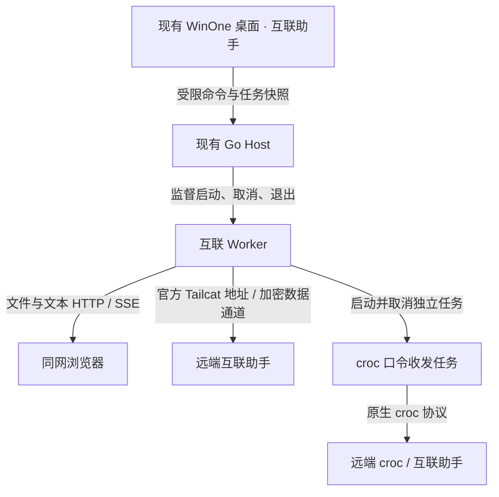

# 互联助手：调研与设计

日期：2026-10-24。状态：FileShare 开始直接接入；跨网分享与聊天替代仍在验证，整体尚未完成。

目标是在「快捷助手」下增加「互联助手」，在 WinOne 内完成文件分享、局域网文件与文本互传、跨网口令传输、点对点聊天及 TCP 端口穿透。用户于 2026-10-24 明确授权：参考方案不适合 WinOne 时，分享码及其他实现均可改用成熟、持续维护的最新开源方案。这里的“最新”优先指已发布稳定版本，主分支变化另行核查。

## 一、参考方案审核

| 原方案内容 | 查证结果 | 实施决定 |
| --- | --- | --- |
| 用 mygo 重新建立整个宿主、单文件发布 | 当前已有 Go Host、Rust 桌面组件宿主、命名管道、独立 Worker；mygo 用于结果窗。重建宿主与本任务不相称 | 沿用现有宿主、组件、监督进程与构建入口 |
| 直接完整复制 Tailcat-Box | 当前许可证为 PolyForm Noncommercial 1.0.0，带非商业使用限制。不能作为普通 GPL 兼容依赖直接合并分发；历史 LICENSE 记录也未提供可直接采用的 MIT 版本 | 不复制其受限实现或品牌资源；采用 BSD-3-Clause 的官方 Tailcat |
| `tc-mew-...`、`tc-tun-...` 是上游分享码 | 官方地址是 `tc…`；Tailcat-Box 喵传另用 `mw1.`，旧格式为 JSON。原方案示例不是实际协议 | 使用官方地址与 croc 原生口令；二维码编码真实连接内容，不自创密码学或伪称兼容 Box |
| 一个 Adapter 就是一个全局网络节点 | Box 的 Adapter 管理多个 Server、Client 和房间。对象单例不等于网栈单例 | 管理器统一，连接按服务和授权范围隔离；分享地址不得同时开放聊天和本机端口 |
| 一次打洞即可让所有人、所有业务直连 | NAT 穿透是具体两端路径的协商；多对端可同时走不同路径 | 状态按任务/对端显示“直连”或“中继”；未连接不显示假延迟 |
| 无公网服务器 | 无需账号和自行部署，但初始建立连接仍依赖 DERP；免费公共 DERP 有限速 | 说明依赖，保留自定义 DERP；连接失败给出真实错误 |
| 300 MiB 按单文件划分，文件夹已支持 | Box `miao/stage.go` 按整份分享总量分流，且拒绝目录 | WinOne 明确支持文件与目录，保留层级；准备阶段可取消；小分享缓存、大分享按原位置读取 |
| 大文件零拷贝并加只读锁 | 未查到该承诺对应实现；加密流不等于端到端零拷贝，长期锁会干扰源文件操作 | 表述为“不额外复制、流式读取”；源文件变化/失效须报错 |
| 原样嵌入整个 FileShare `public/` | `admin.html` 和管理命令依赖 Tauri；公开客户端有独立资源和接口 | 复用 MIT 客户端与行为，WinOne 负责本机管理；管理能力不暴露给局域网 |
| LAN 只有四个 API | 实际还有条目列表、文本发布、列表 SSE；管理端和客户端均可发布文本 | 完整保留文件、文本、复制链接、多网卡、源文件失效和实时列表 |
| 10 GB 上传和断点续传 | 上游限制是整个 multipart 请求 10 GiB；Range 是下载续传，不代表上传续传 | 正确标注单位、请求上限与下载续传边界；防止完整文件进入内存 |
| croc/v9 + New + 外挂 Context 即可即时取消 | 最新稳定版为 v11.5.5，有 `NewCtx`；普通 `New` 不会自动接受外部 Context | 锁定 v11，使用实际取消接口，验证等待连接、准备文件及传输中的取消 |
| croc 现成提供 UI 进度及每任务代理 | 进度主要接终端；CLI 输出目录会修改工作目录，代理等可能是进程级配置 | 受控进程隔离，结构化报告真实进度；必要的上游适配保留来源和补丁 |
| 常驻全局剪贴板嗅探、拖入任何地方立即分享 | 存在误发与常驻开销；与 WinOne 其他拖拽目标冲突 | 在互联页面明确接收拖拽；剪贴板识别必须可关闭；分享动作保留清晰回执 |
| 默认注册右键菜单、悬浮球 | 系统集成需要用户可控开关，与本机菜单保护共存 | 通过设置显式开启，关闭/卸载恢复本应用拥有的登记；浮动收件入口按需开启 |

另：Tailcat-Box 最新版还增加了语音、视频、屏幕共享、内置 SSH 等。它们超出参考文件列出的功能目标，不把“替换不适用实现”扩大为新增远程控制产品。

## 二、采用的来源

| 项目 | 本次核对版本 | 用途与许可 |
| --- | --- | --- |
| [Tailcat](https://github.com/tailscale/tailcat/releases/tag/v0.7.0) | v0.7.0，`15ab9e68bfc6534a61797d7af28cedd42b54a3a5`；另核对主分支 `52fbad323e9d352f1febb623e0975368e9a8cbdd` | 官方点对点连接、地址解析、路径状态及 TCP 转发，BSD-3-Clause |
| [croc](https://github.com/schollz/croc/releases/tag/v11.5.5) | v11.5.5，`8a806c36956533f9c003c55f16e31fcf14133f8e`；另核对主分支 `9c28c3bd3ddaf106ea32192ef9bc807e999b1367` | PAKE 口令、文件/目录传输与续传，MIT |
| [FileShare](https://github.com/tri5m/file-share/tree/7228df100f687cd33332331e9c590606623408e4) | `7228df100f687cd33332331e9c590606623408e4`，package.json 1.0.13 | 局域网免安装 Web 客户端、文本/文件互传交互，MIT |
| [Tailcat-Box](https://github.com/mushroom11s/Tailcat-Box/tree/c7053dd02bbbd15c17bb38656fb81ec2d59b8da5) | `c7053dd02bbbd15c17bb38656fb81ec2d59b8da5` | 仅调研；PolyForm Noncommercial，不导入实现 |
| WinOne 已有 shadcn/Base UI、Lucide、共享样式 | 当前仓库版本 | 组装桌面页面，保留已有来源清单与主题 |

关键源码依据：Tailcat 的 `tailcat.go`（`Server`、`Client`、`ParseAddr`、凭据与状态）、`listen.go`、`cmd/tailcat/forward.go`；croc 的 `src/croc/ctx.go`、`client_state.go`、`src/cli/cli.go`；FileShare 的 `src-tauri/src/server.rs`、`downloads.rs`、`assets.rs` 与 `public/`；Box 的 `LICENSE`、`internal/adapter/real.go`、`internal/miao/payload.go`、`stage.go`。上述文件均以表内提交定位，不以 README 宣传代替接口依据。

复制实现或引入依赖时同步原始许可证、直接及传递依赖清单、版本、摘要和改编说明。调研引用不代表已经导入或通过分发验证。

## 三、直接复用决定与边界

用户已明确选择「没有，采用许可兼容的成熟替代」，不再重复询问 Tailcat-Box 的额外授权。FileShare **直接复用 Rust 服务、完整客户端和原始测试**，不采用原方案的 Go 重写。croc 保留完整原生引擎；WinOne 只适配宿主接口、配置、界面与生命周期。

持续分享及端口映射补充审查 [WhiskerLink](https://github.com/DavidCarliez/whiskerlink)：MIT，主分支 `e16da6c582d4b8b8d00878bcf12c4be084b2a5d1`，最新 release v0.1.0。源码包含文件/目录清单、SHA-256、续传、接收前检查、碰撞策略、持久身份和 TCP 服务管理。项目较新，尚不能凭 README 宣称成熟，必须先核对真实行为。

聊天补充审查 [Chitchatter](https://github.com/jeremyckahn/chitchatter)：package.json 明确声明 GPL-2.0-or-later，可按 GPLv3 组合义务接入；已有房间、Markdown、代码高亮、文件传输和重连实现。尚未导入；需锁定生产分支、检查依赖及本地嵌入的连接行为。不会自行编写聊天协议，也不会用 FileShare 文本列表冒充聊天。

300 MiB 缓存分流、短码命名、次数和有效期不作为重新发明引擎的理由。对应行为以许可兼容的完整上游为准，最终差异逐项记录；当前表格中的相关内容仍是待验证目标。

## 四、架构与数据边界

互联助手作为现有 Host 管理的工具页，网络引擎放独立按需 Worker，避免把 Tailcat/croc 的 Go 1.27.1 依赖提升到整个 Host。Host 继续控制真实配置、窗口身份和退出；文件字节走网络与磁盘，不通过 JSON UI 通道。

图示是实施设计，不是已经验收的调用关系。

- 关闭页面不终止已开始的传输；停止分享、停止服务、取消任务和退出应用是明确操作。退出必须等待监听器与文件句柄回收。
- 无运行任务时不保持外网连接；禁用后不监听、不轮询。UI 只在页面可见时订阅或读取快照。
- 分享、聊天、穿透分开授权；不能用文件分享地址访问同时开启的本机服务。公开地址含访问凭据，不写入普通日志。
- LAN 服务使用随机访问凭据、严格来源与 Host 校验；选择网卡会改变实际监听范围，不只替换二维码。HTTP LAN 不宣称端到端加密。
- 上传使用临时文件和成功后提交；不覆盖同名文件，不执行上传内容。拒绝路径穿越、Windows 设备路径、ADS、符号链接逃逸；取消/失败保留可解释状态。
- 穿透客户端默认只监听回环地址；只有用户明确选择才允许局域网访问。本机映射监听成功后才显示可用。
- 会话凭据与本机文件路径不随便携偏好导出。持久分享保存必要密钥及文件清单，恢复时重新检查文件，失败不显示“运行中”。
- croc 口令使用上游生成与解析，不降低口令熵、不固定密码；设置保留中继、代理、网络模式及冲突处理。

## 四、功能对照与界面

一级入口固定在「快捷助手」之后。页面使用现有字体、灰阶、单行 Tab、平面分组和紧凑任务行。设计参考 taste-skill 的应用界面规则；选用 achromatic-ledger 的中性结构，继续使用 WinOne 原有令牌，不复制另一套全局外壳。

| 功能 | 页面与真实操作 | 核查重点 |
| --- | --- | --- |
| 文件分享 | 创建分享、添加文件/文件夹、复制地址/二维码、查看内容、接收、停止、恢复；每份分享独立有效期与次数 | 多文件、目录层级、小文件缓存、大文件原位读取、取消、源文件改变、重启恢复 |
| 局域网互传 | 开关服务、网卡/地址、二维码、文件/文本列表、上传下载、复制文本/下载链接、移除共享 | 手机浏览器、Range、SSE、10 GiB 请求上限、同名文件、安全边界 |
| 口令传输 | 发送/接收、文件与目录、口令/二维码、输出目录、进度、取消、失败重试、续传 | croc 官方客户端互操作、自定义中继/SOCKS5、重名策略、空文件/空目录 |
| 点对点聊天 | 创建/加入房间、文本、Markdown/代码、文件消息、复制连接、断开 | 消息顺序、重连/断开、草稿保留、文件卡片真实下载、限长与安全渲染 |
| 端口穿透 | 分享本机/指定 LAN TCP 服务，建立本地映射，停止，路径/流量/连接数 | 双向数据、端口占用、拒绝无效目标、连接回收、回环默认值 |
| 常规设置 | 下载位置、网络配置、后台行为、剪贴板识别、悬浮收件入口、资源管理器发送入口 | 配置保存、未保存保护、启停及卸载归还本应用资源 |

传输区先显示“选择文件/文件夹”和“输入地址/口令”，任务列表占主体。二维码按需展开；不常驻占据宽栏。聊天有独立标签，不把长对话挤进窄抽屉。错误显示在对应任务附近，并提供可执行的重试或更正操作。

普通窗口显示名称、方向、已传/总量、速度、状态与取消；窄窗把次要信息移到第二行，所有信息仍可达。未知总量显示准备中或等待连接，不伪造百分比。路径可以省略，但保留完整提示和复制。中英文、深浅色、空态、长名称与高 DPI 一并核查。

## 五、验证范围

2026-10-24 09:57（Asia/Shanghai）环境探测：成功读取 `https://tailcat.dev/derpmap.json`，返回 4 个区域；`croc.schollz.com:9009` 和 `croc6.schollz.com:9009` 的 TCP 建连成功。此结果只证明本机当时的入口可达，可能受本机代理影响，不是 RTT、吞吐量、P2P 打洞或异地手机传输证据。

实施验收必须覆盖：

1. 真实回环 HTTP 上传/下载、Range 与不完整上传；路径和凭据边界。
2. 两个隔离实例的 Tailcat 分享、聊天、TCP 回显；分别记录直连与中继证据，不能用同机结果冒充跨 NAT。
3. 两个 croc 端点的文件/目录、取消、重名、续传和错误口令。
4. 页面切换、未保存内容、关闭窗口后台任务、停止和应用退出；禁止影响真实安装和用户服务。
5. 现有前端/Host/Rust 检查、来源及许可证检查、完整构建和安装包记录。
6. 记录完整进程组资源增量、首次启动、运行中、空闲及退出；未测的跨设备/异地环境明确列出。

## 接收流程与本轮功能对照（2026-10-25）

用户纠正：croc 不要求双方连接同一 Wi-Fi。主入口为 **扫码接收（不限网络）**，直接使用 croc 官方 `https://getcroc.com/?code=…`；局域网是可选直连，不是互传的使用前提。接收区用整体居中的「扫码接收 / 局域网直连」Tab 切换，默认扫码接收；一次只显示一个二维码，发送后直接展示并定位到居中接收区，轮询不重置所选 Tab。两个二维码不能互换：一个进入公网 croc 网页，另一个进入本机凭据保护的 HTTP 文件池。Tailcat 地址仅供 WinOne 持续分享使用，不能称为手机网页口令。

来源核对：锁定 croc v11.5.5 的 README “Show QR Code / Data transport selection” 与 `web/src/App.tsx` 的 receive-only、接收确认和浏览器下载路径。默认 `auto` 可与网页客户端回退到 croc 中继；严格 DERP、自定义中继/口令设置不展示不可用的网页链接。沿用现有 FileShare、Chitchatter 和 WinOne shadcn/Base UI，不引入另一套协议、控件或依赖。

| 上游能力 / 用户任务 | WinOne 入口与实现 | 本轮验证入口 |
| --- | --- | --- |
| 文件、文件夹、文本一次选择发送 | 文件互传主表单；持续发送默认 `share_add` / `share_add_text` 加入当前池；可显式新建独立分享 | 布局测试检查只创建一项任务，真实手机测试检查文件后文本、链接不变 |
| 手机与电脑跨网网页接收 | croc `browserUrl` + 官方二维码；接收端兼容粘贴网页链接 | `browser_test.go` 能力边界与链接解析；`test-interconnect-croc-web.mjs --public` 显式公网测试 |
| 局域网直接下载、文本、可选上传、网卡选择 | 可选局域网二维码、只读/上传设置、源文件管理、另存为、下载链接 | `test-interconnect-phone.mjs` 真实进程、下载字节、权限、停止通知 |
| 端口已占用 | 保留已有监听者，自动绑定空闲端口，地址/二维码使用实际端口 | Rust `automatic_port...` 及手机测试占用端口 |
| 持续分享与恢复 | 明确标注 WinOne 地址、使用路径和独立中继错误；停止/恢复、增删文件和文本仍可用 | Peer 真实 Tailcat 分享与停止；统一发送验证口令完成不关闭文件池 |
| 口令选项与进度 | 保留中继/IPv6/代理/本地发现、transport、曲线、hash、碰撞策略、ZIP、排除、压缩、限速、确认和取消；低频项收进高级选项 | Transfer 原有集成测试及 TypeScript；继续现有完整能力，不删选项 |
| 托管分享、撤销、接收清单与过期次数 | 保留原独立托管标签、真实 storeclient 路径 | Transfer 原有测试、布局发布/撤销流程 |
| 创建/加入房间 | 官方图标与标题横排居中，创建/加入纵向排列；加入后显示房间标识/密码占位提示 | 真实 WebRTC、双语/深浅色/窄窗、原生窗口测试 |
| 房主单人发送与晚加入历史 | Chitchatter 群聊显式启用历史合并，去重并保留最近 150 条；私聊不共享历史 | 165 项核心测试及三端真实 WebRTC（单人发送、晚加入、重进、私聊隔离） |

公网网页互操作、真实异地手机网络、完整安装器的最终验证状态以 `docs/development.md` 为准；不能用同机回环或端口可达代替跨 NAT 证据。

## 六、实施顺序

详见 [互联助手实施计划](互联助手实施计划.md)。所有能力逐项完成和核查后才能称为完整交付；原型、构建成功和端口可达均不代替功能验收。
