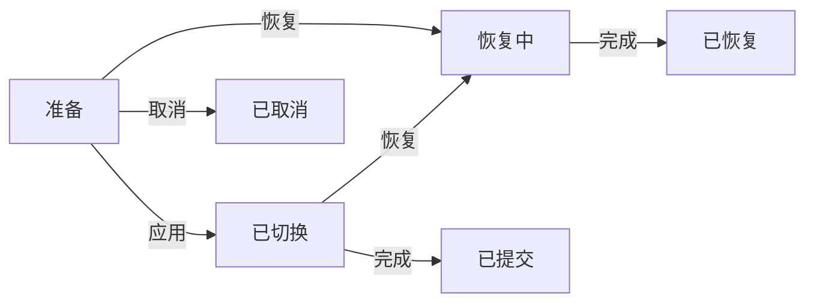

# 可选模块接入

新增模块统一使用原生控件与WinOne风格，复用共享原生UI宿主、控件库和运行时；不再接受网页界面作为目标入口。性能预算、同负载原型和完整进程组资源增量是接入门槛。已有包版本、配置与恢复协议继续保留，UI入口兼容规则按[模块契约](模块与配置契约.md)迁移。

状态：实施中。当前可用的是截图、划词助手、置顶和程序管理四个内置模块；不把清单校验或内部注册接口称为已支持下载安装扩展。

## 遗留暂存检查与安装器（2026-10-08）

新准备记录、旧暂存发现和旧迁移备份核对已接入现有清理入口。未核验内容保留；登记/事务引用与备份关系在清理前重新检查。实际 Host、后端回归及完整覆盖/回滚/卸载检查通过，已更新仓库固定安装器。详见 [安装准备与清理](安装准备与清理.md)。接下来实现 [共享依赖](共享依赖设计.md) 的版本并存、依赖锁定和引用保护；设计文档不代表该能力已实现。

## 安装准备记录（2026-10-08）

新增暂存与迁移备份现在先记录归属，再写载荷或备份；登记、待处理事务接管与现有清理入口已经连接。写入失败保护、接管后备份保护、只有准备账本时的升级预检，以及候选构建已验证。此前没有记录的遗留目录和完整共享依赖仍未完成，详见 [安装准备与清理](安装准备与清理.md)。本轮未替换固定安装器。

## 整应用升级预检（2026-10-08）

新 Host 的只读预检已接入整包覆盖之前。有效但不兼容的模块以及未完成配置、包或恢复事务会拒绝升级；已损坏、缺失或不受信任的扩展按正常隔离策略保留配置。控制文件摘要绑定检查结果，前后变化拒绝；不执行扩展或迁移。定向与真实 Host 检查通过，完整安装器结果以 [开发状态](development.md) 为准。详见 [整应用升级预检](整应用升级预检.md)。

后续仍有共享依赖、未登记暂存和准备失败备份整理、真实扩展负载及正式版完整验收；用户尚未确认缩减首版范围，保留原定范围。

## 跨配置版本迁移（2026-10-08）

更新与保留配置重装已支持签名包中的有界迁移规则，并将可核验备份接入更新、中断恢复和清理记录。正常迁移、失败回退、配置文件占用、提交中断及损坏备份的真实 Host 场景通过；361 项前端与 16 组原生布局/完整流程通过。详见 [模块配置迁移](模块配置迁移.md)。后续继续共享依赖及整应用升级预检，历史“迁移待完成”描述按此状态解释。

## 版本更新与退役文件清理（2026-10-08）

同配置 schema 的版本更新、配置/启用意图保留、失败回退与退役文件重试清理已接入产品 Host 和共享界面。正常、关闭、无效程序、旧/新程序拒绝恢复确认、文件占用及重启/卸载/重装均完成真实流程。16 组原生界面布局、360 项前端测试及相关后端/构建检查通过，首次安装后 Host 41.73 MiB 位于用户接受范围。见 [模块版本更新与恢复](模块版本更新与恢复.md)。

后续直接推进共享依赖、跨 schema 迁移和整应用升级预检；未登记暂存及真实扩展负载继续保留为待完成项，不再回到非阻断内存微调。

## 本地安装、卸载与重装（2026-10-08）

工具管理的原生文件选择、签名来源预览、确认安装、卸载回收和保留配置重装已贯通真实 Host 与共享设置页。取消不安装；失败检查可直接重试。配置文件或模块状态文件被占用的失败恢复、默认关闭、启用调用、重启和完整进程组退出均通过。前端 357 项、Go 源码范围测试、静态检查、Rust 构建和 8 组原生布局通过。详见 [本地模块安装与卸载](本地模块安装与卸载.md)。

首次安装后 Host 私有工作集峰值 **42.13 MiB**。用户于 2026-10-08 接受约 43 MiB，并要求优先完成正式版；该场景已通过调整后的 Host 空闲检查，不再阻断进度。下一步直接接版本更新、清理反馈、共享依赖、配置迁移及整应用升级预检。本轮仍保留已交付安装器，待所需功能和完整流程完成后统一更新。以下历史“待接入”和 40 MiB 超标描述按该最新状态解释。

## 故障隔离与恢复（2026-10-08）

坏包、无信任、缺失登记、配置不匹配和未完成包变更已按模块隔离；工具管理显示不可用状态、原因和恢复入口。原始配置、启用选择及关闭标记保留，其他设置和 WinOne 日志可访问。恢复在统一配置队列中校验旧包与配置，持久记录关闭过程，并要求 Worker 明确确认恢复且实际退出。完整 Host 与实窗检查通过，详细边界和证据见 [模块故障隔离与恢复](模块故障隔离与恢复.md)。

下一步按完整安装任务推进来源预览、首次登记与配置提交、更新/卸载协调、回收反馈及共享依赖，再补可选配置的整应用升级预检。不能把既有恢复入口称为已支持任意扩展安装。Host 私有工作集仍略超预算，正式版性能与真实扩展验收继续保留。

## 动态配置接入（2026-10-08，前置接口已验证）

`configuration.HostStore.RegisterPackageModule` 与 `UnregisterPackageModule` 现已接入统一配置事务。包适配器由可信协调器提供，声明 `PackageSchemaVersion`；这些内部参数不接受前端传入，也不代替包签名验证。新模块默认关闭，配置投影完成后才允许启用。目录变更与配置提交共用串行操作锁，读取仍返回上一份已提交快照；调用方还需在安装过程中持有 Host 配置队列的维护许可。

卸载通过生命周期恢复资源后再提交配置移除，失败恢复原启用意图与配置。未完成补偿时保留适配器和事务，恢复后可重试；重启不采用未提交目标。已登记包的配置和启用项必须同时存在，只有登记/移除事务中的整个可选项可以同时缺省，内置模块和未知开关仍严格校验。

本机卸载保留数据新增至配置文档的 `retainedModules`，内容带配置 schema 版本；兼容重装后恢复为关闭状态。该区域与跨设备导入的 `deferredModules` 分开：本机路径和未经过导出适配器处理的数据不进入 `.winone` 档案，导入其他配置也不覆盖本机保留数据。存在待转换的导入配置或 schema 不匹配时明确拒绝自动采用，不丢弃原数据。

验证覆盖实际配置文件的登记、保存、移除、重开、重装、失败补偿、恢复、旧修订和并发提交；产品 Host 的现有 `modules.setEnabled` 处理器已通过运行中新增配置登记的联动测试，且移除后四个内置模块仍可保存。导出/导入检查确认本地保留数据不会外流或被覆盖。全部 Go 源码包测试及配置/Host 的 `go vet` 通过；本机没有 C 编译器，本轮未运行 Go race 检测。证据：`_temp/repository-hygiene-20261008-9513b969/archived-dist/optional-configuration-20261008/`。

**后续接线已推进**：`apps/host` 的启动包发现、签名配置定义、维护队列中的配置保存和按需运行已接通，见 [模块包配置与 Host 发现](模块包配置与发现.md)。正式构建的信任根仍为空；没有把测试公钥加入产品。当前仍未替换已交付的 AI 登录安装器。

后续顺序以本文开头为准。故障包隔离与启动恢复已推进；整应用升级预检、来源预览、安装、启停与卸载的完整实窗任务仍待完成。已取得 Host 与签名测试 Worker 的资源记录，但 Host 工作集仍略超预算，真实扩展负载也尚未验收。

## 当前代码复核（2026-10-07）

- `Registry.PrepareModule` 已串联签名包登记与 `modulestate.BindPackage`，新包默认关闭；`Resolve` 会重新验证信任、兼容性和文件。
- `modules.Control.RegisterPackage` 现可在运行中同时登记包 Gate 与 Host 命令，目录和启停快照同步；冲突时不留下单边登记。原有 `TestControlUsesRegisteredCatalogForOptionalModuleLifecycle` 预先创建扩展 Gate，不作为新能力的证明；新增测试在 Control 创建后才准备并登记 Gate。
- `RuntimeModule.Unload` 与 `Control.UnregisterPackage` 已接通运行时移除：模块必须关闭且恢复完成；旧 Gate 永久失效，旧登记的重试不能移除同名新实例。此操作保留包文件、登记文件和配置，尚不是完整卸载事务。
- 登记 v2 已实现准备、切换、恢复和结束记录，并协调单独的模块摘要绑定。重试不重复更改版本或启用偏好；文件回收及产品协调器仍待接入。
- `apps/host` 尚未使用 `modulepackage`；包校验、登记、Worker 加载、配置适配及产品入口仍未贯通。不能仅给首页增加按钮后声明支持扩展。

内部运行时切片已用真实签名测试包贯通“私有暂存 → 重新验证 → 默认关闭登记 → 运行中绑定 → 显式启用调用 → 禁用并确认退出”。这条证据使用共享 Host Service 与真实 Worker，不是已接入产品 `apps/host` 的安装入口。继续使用 Host 唯一的模块状态、共享 Gate、按需 Worker 及既有包校验。测试密钥只在测试进程中生成，不进入产品信任根。

后两步：完成包文件回收与产品 Host 的发现、配置、事务协调；再接来源预览、安装确认与共享声明式设置 UI。每步用公开调用和实际进程退出验收，不把内部对象回调当成完整运行能力。正式发布者身份及下载渠道仍按用户要求暂缓。

### 内部运行时验证范围

`Registry.LoadModule` 重新核对签名、兼容性、文件和启用状态中的摘要，再接入当前 Control。加载与启用均不提前启动按需 Worker。每次新进程启动前重新核对文件；每次请求重新查询可信发布者。撤销信任后拒绝新工作，但仍允许原进程完成资源恢复和退出。

关闭失败保留 `PendingStop`，可重试；成功必须等到实际进程退出。Host 关闭运行时不改变用户启用偏好，取消 Host 退出后可以恢复按需调用。包 Worker 的读取命令也可能触发进程启动，因此所有包请求都遵守 Host 维护锁；内置配置适配器原有的只读规则不变。

最新验证：7 个相关包的 197 项顶层测试通过，14 项需要显式环境的测试默认跳过；另显式验证正常升级和损坏可执行文件后的回滚，保留原启用偏好及配置，并核对实际进程映像路径和退出。常规测试不启动这个 Worker，不修改用户程序、快捷键或系统配置。最新日志：`_temp/repository-hygiene-20261008-9513b969/archived-dist/package-change-20261007/`；此前运行时启停、信任撤销、运行中移除及文件保护记录保留在 `_temp/repository-hygiene-20261008-9513b969/archived-dist/module-unload-20261007/` 和 `_temp/repository-hygiene-20261008-9513b969/archived-dist/module-runtime-20261007/`。

复现真实进程测试：设置 `WINONE_MODULE_RUNTIME_INTEGRATION=1` 后运行 `go test ./internal/modulepackage -run '^TestRuntimeSignedWorkerLifecycle$' -count=1 -v`。测试程序复制自身进入临时签名包，测试密钥不落入产品。默认只支持此切片已经接通的按需、无快捷键入口；声明配置驱动启动或快捷键的包明确拒绝，待对应 Host 适配器接通后扩展，不能静默忽略声明。

### 运行文件与移除保护

启动前先持有清单列出的有效载荷和控制文件，再重新验证签名与文件。文件句柄拒绝写入和删除，目录句柄拒绝路径链中的改名；已存在写入者时拒绝取得保护。句柄保持至 Worker 关闭，关闭失败仍保留保护；验证失败、取消或正常关闭释放句柄。配置和日志目录不得位于签名包内部。

已覆盖：运行中文件不可写、包目录及上级目录不可改名、保护下仍能完成只读验证、部分取得失败后的释放、取消、超过 260 字符的路径，以及目录链接拒绝。测试在没有符号链接权限时使用普通用户可创建的 Junction；本机链接拒绝分支已通过。当前执行路径不接受目录链接别名，不把该限制当作全路径兼容已完成。保护范围是已验证文件及路径身份，不宣称对可信模块代码提供安全沙箱。

运行时移除用独立登记对象识别具体路由，只有资源恢复完成后才撤销；捕获旧回调的请求也受 Gate 的永久失效标记约束。状态查询不会等待长时间的资源检查，重复移除不能干扰新实例。`Unload` 只移除内存目录和命令，尚未删除持久化登记或文件。

依据：[Microsoft CreateFileW](https://learn.microsoft.com/en-us/windows/win32/api/fileapi/nf-fileapi-createfilew) 的共享访问、删除/改名及 `FILE_FLAG_OPEN_REPARSE_POINT` 规则。

### 持久化包变更（登记 v2）

`BeginChange` 在同一个原子登记文件中保存旧包、候选包、原启用偏好和操作版本。`ApplyChange`、`RestoreChange` 先保存切换方向与目标登记，再用 `ReplacePackageBinding` 比较并切换独立状态文件中的摘要。因此任何一个文件写入失败，重开后都能确定继续升级还是恢复旧包；不会凭当前文件存在就报告完成。

图中应用、恢复、完成、取消分别对应 `ApplyChange`、`RestoreChange`、`FinishChange`、`CancelChange`；只表示登记与绑定事务，Worker 验证由外层协调器负责。取消只接受尚未改变原启用状态的准备阶段，否则必须恢复。图已用本地渲染器检查。

待处理模块拒绝普通加载，也拒绝已有 Worker 的新调用。候选检查需要由 Host 提供绑定操作 ID 和登记版本的 `ChangePermit`，运行时复制该许可，旧许可不能因同名操作重用而扩大范围。结束前重新验证目标包，并要求恢复原启用选择；移除则必须保持关闭且清空包绑定。`FinishChange` 不代替候选 Worker 的健康检查。

只保留最近一次完成回执，用于重复请求；过期操作返回冲突，不能误删重装后的同名包。旧 v1 登记可以只读打开，下一次成功写入升级为 v2；损坏记录、错误阶段/版本组合和未知字段拒绝读取，不自动覆盖。新记录不由旧读取器静默忽略。

已验证：登记写失败不改变绑定；绑定写失败时切换/恢复方向已经落盘；重开后继续操作不重复推进版本；原启用状态变化后不能直接取消；重装后的旧移除请求不改变新实例。真实签名测试包完成 1.2.0 → 1.3.0，损坏的已签名程序被 Windows 拒绝启动后恢复 1.2.0。Worker 没有创建成功时，保留原始启动错误，不再用缺失管道错误覆盖。

当前只提交登记和绑定。旧、新阶段目录仍保留，尚未回收文件；真实进程测试调用共享 Host Service，不是已接入产品 `apps/host` 的安装入口。生产协调器仍需串联配置互斥、关闭/移除、候选检查、偏好恢复及最终确认。

尚未验证或接通：包文件回收、产品 Host 启动发现与安装命令、配置中心适配、共享依赖、完整资源增量、来源预览及声明式设置界面。当前库级连接不能替代这些产品验收，也不能宣称已支持任意第三方模块。

## 当前与后两步

1. **统一目录与身份**：保留内置模块ID，扩展使用发布者命名空间。清单、Host命令分发、设置预览、导航和启停列表读取同一已安装目录。先补齐清单与已有服务的命名保护，再建立包版本、兼容、依赖和安装状态记录。
2. **本地包闭环**：选择本地包、核对来源/版本/能力/兼容性、验证签名与文件、暂存、提交登记；默认不自动启用。简单设置使用WinOne声明式表单，特殊界面使用审核后的本地UI资源。安装失败不登记半成品；卸载先禁用并恢复资源，默认保留配置。
3. **下载与升级**：可信目录接入同一安装事务，增加共享依赖、版本切换和失败恢复。与WinOne更新共用任务协调及可信发布配置，不另建自动运行入口。增加新模块时验证Host、Worker和WebView2整体资源增量。

## 已确认的实现缺口

- `catalog.Manifest`覆盖身份、名称、Worker、启动策略及设置版本；`modulepackage.Metadata`和签名/文件校验已接入库级加载。共享依赖及产品包管理入口仍待接通。
- Host与`modules.Control`已共用已注册功能清单；运行中添加/移除 Gate、目录及路由已有库级实现。产品 Host 发现、持久化安装/卸载事务与配置中心的连接仍未完成。
- 模块状态和配置事务目前围绕四个内置模块，安装/卸载需要把目录登记、启停意图和设置保留纳入统一恢复记录。
- 前端尚无本地模块安装、来源核对和卸载入口；新入口放在工具管理，不复制主题、语言或产品设置。
- 发布者身份和信任根尚未配置。设计签名验证接口时使用成熟实现，不自定义“等同TUF”的协议；开发测试密钥不得成为正式信任根。

## 命名与生命周期约束

- 扩展不可占用`capture`、`always-on-top`、`wintray`以及`settings`、`modules`、`shortcuts`、`residency`、`profiles`、`application`、`updates`、`packages`命名空间。
- 注册前同时检查已有功能和内部服务：相同名称、父名称、子名称都视为冲突，防止最长前缀路由改变原命令归属。失败不得改变原目录或路由。
- 只有安装校验完成的模块能登记。内部`RegisterFeature`不是给配置文件或网页调用的安装入口。
- 关闭/卸载完成必须以资源恢复和进程退出为准。失败保留恢复入口，不直接杀进程后写成已关闭。

## 包元数据v1

`modulepackage.Metadata`复用运行时模块清单，额外声明包版本与兼容要求。元数据最多64 KiB；拒绝重复字段、未知字段、额外JSON和不支持的版本。外部包只能声明optional模块，不得伪装成内置模块。

- 包版本与Host版本沿用WinOne已有版本格式及SemVer比较。
- Host范围为`minimumHostVersion`包含、`maximumHostVersionExclusive`不包含；不接受空范围。
- 协议和设计系统版本必须精确匹配，平台目前识别`windows-x64`及`windows-arm64`元数据；这不表示WinOne已发布ARM64版本。
- `minimumWindowsBuild`声明模块所需系统版本，检查时与Host实际环境比较。
- 一次返回所有不匹配原因；Host环境读取失败或版本未知时不能报告兼容。

检查是只读数据处理，不读取Worker、不加载UI、不验证发布者签名，也不授予安装或执行权限。Host环境必须来自已安装WinOne，不能由待安装包提供。后续签名、文件摘要、路径与依赖验证不可省略。

## 验收任务

签名错误、损坏包、路径穿越、不兼容版本、缺失依赖、名称冲突、安装中断、升级中断、恢复失败、卸载保留设置、重新安装恢复设置，以及新增模块不常驻的资源验证。

来源核对、安装确认与真正执行的模块必须一致；不能把“已选择包”当作授权包内任意启动项或独立UI。

## 签名清单v1

采用Minisign现有实现`aead.dev/minisign v0.3.0`验证小清单原始字节。清单格式标记为`winone.module.v1`，包含元数据及全部有效载荷的相对路径、大小和SHA-256。清单最大1 MiB，签名最大8 KiB，最多4096个有效载荷文件；单文件最大256 MiB、总量最大2 GiB。实际读取和安装仍须逐文件流式校验，不能按这些上限整包分配内存。

可信配置提供发布者命名空间和公钥，不能采用包内自报的公钥；通过签名后仍检查命名空间一致。文件清单拒绝Windows保留名、重复大小写路径、文件与父目录冲突、元数据文件自引用、缺失Worker或许可证。校验结果返回拷贝，避免预览修改已验清单。

签名清单校验现由归档、暂存、登记和库级运行时复用；产品安装事务及其失败恢复尚未接通。正式信任根尚未配置，测试密钥仅在测试进程内生成，不写入产品或仓库。本机制不宣称实现完整TUF更新保护。

依据：[Minisign Go实现及API](https://github.com/aead/minisign)、[Minisign原实现](https://github.com/jedisct1/minisign)，2026-10-02核对使用方式并锁定版本。许可证原文与摘要记录在`third_party/sources.json`；接入实际运行路径时还需加入运行时依赖声明。

## 归档校验v1

模块归档采用普通单卷ZIP，包含`module.json`、`module.json.minisig`和签名清单列出的文件。不接受ZIP64、目录/链接条目、重复大小写路径、未列出文件和尾随数据；目录由安装器根据已验证的文件路径创建。

解析前按ZIP规范核对目录记录与数量，中央目录最多8 MiB，并保存只读快照后再调用Go标准ZIP解析器。签名和元数据检查通过后，使用复用的64 KiB缓冲逐文件核对大小、CRC和SHA-256，不读取整包到内存。归档总大小限制为有效载荷上限加32 MiB开销。

当前验证不解包、不注册、不运行模块。文件可能在检查后变化；安装阶段必须校验私有暂存副本，并绑定用户确认的签名清单摘要，不能把一次检查结果当作永久执行许可。

已覆盖实际文件篡改、缺失/多余文件、链接、目录数量伪造、尾随数据、取消及目录读取后源内容变化。依据：[PKWARE APPNOTE](https://pkware.cachefly.net/webdocs/casestudies/APPNOTE.TXT)第4.3.12、4.3.16节和当前Go标准库`archive/zip/reader.go`，2026-10-02核对；未重写解压算法。

## 私有暂存

`StageArchive`要求Host提供明确的绝对暂存根目录、可信发布者、真实环境和用户确认的清单SHA-256。先重新核对签名、摘要及兼容性，符合后才建立随机独立目录。

写入复用归档校验循环，通过`os.Root`限制目录范围，并使用仅新建模式避免覆盖文件。逐文件检查大小、CRC和摘要，成功文件同步落盘；最后写入原始签名清单、签名和`.winone-stage.json`识别记录。完成前不返回就绪状态，不注册或启动模块。

失败返回未就绪暂存位置及错误，供安装协调器恢复或清理；不直接删除未知内容。识别记录存在不等于安装提交，恢复与登记前仍须重新验证文件；部分写入、同步失败或进程中断均不得仅凭记录存在而启用模块。

已验证正确文件写入、确认摘要变化、不兼容环境、损坏载荷、已有文件保护，以及缺省暂存目录不得使用当前工作目录。依据：[Go目录限定访问说明](https://go.dev/blog/osroot)及当前`os.Root` API，2026-10-02核对。登记已有库接口；产品安装事务中的恢复与卸载仍待接入。

恢复检查已提供只读`VerifyStage`：通过Host暂存根和严格的暂存ID定位目录，重新验证签名、确认摘要、兼容性、识别记录及全部文件。多余目录/文件、缺失文件、内容变化或记录不一致都阻止就绪；目录分批读取，文件继续流式核验。检查不修复、不删除、不登记、不启动模块，也不把一次校验视为永久执行许可。登记和恢复协调器仍需接入。

## 包登记

Windows包库通过`.winone-module-registry.json`记录模块ID、版本、私有目录ID和签名清单摘要。登记文件最大1 MiB、最多4096条；不记录用户启用意图，也不直接连接Worker。

登记复用维护锁与原子文件写入，先核对预期修订，再重新验证暂存包。相同暂存的重复请求不增加修订或条目；不同暂存不能静默替换已登记模块，同名及父子命名空间均拒绝。损坏登记文件不重置为空，写入失败保留旧内容。

登记快照只是库存信息。使用前通过`Resolve`按当前信任配置、环境和登记摘要重新验证实际文件，模块ID和版本必须一致。动态运行时已有库级连接，配置适配器、持久化卸载及版本回滚的产品协调仍未完成；不能仅凭库存记录显示模块已启用。

## 默认关闭与启停绑定

`PrepareModule`已串联包登记与模块意图绑定。绑定保存本机签名清单摘要，新包默认关闭；登记后意图写入失败时可用同一暂存重试，不重复登记。相同包的重试保留用户后来做出的启用选择；活动包不能被直接重绑，待恢复的关闭事务不能被清除。

包运行接口使用`NewPackageGate`校验绑定摘要，启用、状态查询和调用时都会拒绝过期接口。摘要在关闭及重启后保留。未加载且关闭的包不进入当前已加载配置列表；未加载但启用或待恢复的状态仍报告问题。

协调器必须使用Host唯一的模块状态实例；离线助手需要先排除运行中的Host，不能另开一份内存状态并发写入。动态运行时加载已有库接口，配置适配器、声明式设置页面和产品安装入口仍待接入，产品当前不会自动启动外部模块。

## 参考（2026-10-02已读取）

- [VS Code扩展清单](https://code.visualstudio.com/api/references/extension-manifest)：发布者身份、Host版本要求与声明式入口。只借鉴元数据分工，不引入VS Code运行时。
- [Tauri更新插件](https://v2.tauri.app/plugin/updater/)：发布签名与客户端公钥配置分离。用于校验可信发布边界，不替代WinOne既有安装恢复流程。
- [TUF规范](https://theupdateframework.github.io/specification/latest/)：可信元数据、角色和密钥生命周期，完整保障须按规范实现和验证。

当前验证：登记清单、启用入口、失败保护与快照拷贝已通过Go回归；四模块首页的中英文1280/520像素显示与启停经过独立浏览器验证。测试扩展只有内存回调，不代表已支持安装或运行外部模块包。

## 旧包回收（2026-10-07，库级验证）

登记事务的结束回执先进入独立持久化回收队列，再允许后续事务覆盖最近回执。回收前重新验证签名、完整目录及当前引用；已重新登记的包或含额外文件的目录保留。已核对目录先通过句柄改名到唯一隔离目录，再复核并交给 Windows IFileOperation 回收，禁止退化成永久删除。

记录保留隔离路径和回收阶段。目录改名后中断、回收成功但最终记录写失败均可恢复；丢失回执时只读匹配回收站中的原目录及原父路径，并重新核对包内容。普通回归、真实回收和拒绝最终检查、额外文件/重装保留、丢失回执恢复均已通过；COM 地址改为带类型指针后通过 vet 与 checkptr=2。证据为 `_temp/repository-hygiene-20261008-9513b969/archived-dist/model-picker-20261007/verification/recycle-pointer.log`。

仍待完成：产品 Host 事务协调与配置适配、包管理入口、共享依赖和完整安装/卸载资源验收；当前产品不会自动安装或运行外部包。回收站恢复扫描的耗时不作为常规启动预算，未宣称该异常恢复路径性能达标。
