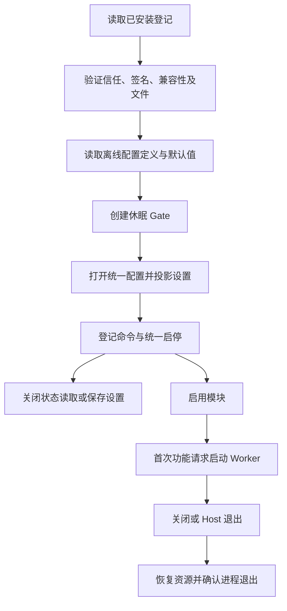

# 模块包配置与 Host 发现

2026-10-08。本页记录已接入产品 Host 的启动发现、统一配置及按需运行。故障隔离和恢复已继续接通，见 [模块故障隔离与恢复](模块故障隔离与恢复.md)；安装向导和完整扩展体验尚未完成。

## 已实现的边界

Host 读取用户目录 `packages` 下的登记记录，重新验证发布者、签名、版本、兼容性及实际文件，再创建休眠的生命周期 Gate。配置中心打开前已取得这些 Gate，因此能恢复扩展的启用意图；配置就绪后才发布模块命令。默认无可信发布者，也不创建测试信任根。

`build/build.ps1` 和 `build/build-host.ps1` 的 `ModuleTrustFile` 可由构建者显式提供发布者公钥 JSON。文件格式为 `{"publishers":[{"Namespace":"发布者命名空间","PublicKey":"Minisign 公钥"}]}`；构建写入 Base64 JSON，Host 再校验格式、公钥和命名空间唯一性。包、RPC 和配置导入均不能修改此信任来源。当前未配置正式发行公钥；测试使用临时生成的公钥编译隔离 Host，私钥不写入产品或磁盘。

图中“创建 Gate”和“启用”均不启动按需 Worker；只有实际功能请求启动。实现位置为 `apps/host/packages_windows.go`、`internal/modulepackage/runtime_windows.go` 与 `internal/configuration/package_modules.go`。该图已用本地 Mermaid 渲染器检查。

## 配置文件契约

包元数据 v2 增加 `settings.schema`、`settings.defaults` 两个包内相对路径，均须在已签名文件清单中。v1 不接受这些字段；v2 不允许省略。读取时再次核对实际字节摘要，不把先前的验证结果当成路径永远可信。

配置定义采用 JSON Schema 2020-12，使用 `github.com/santhosh-tekuri/jsonschema/v6 v6.0.3`。定义最大 256 KiB，配置最大 2 MiB，复用 WinOne 的 UTF-8、重复字段和 32 层嵌套校验。校验器只可使用当前定义的内嵌引用与自带元规范；网络、本地文件及其他外部资源加载全部拒绝。默认值也必须通过定义校验。

Host 编译一次后复用定义；读取和验证不启动 Worker。字段错误只返回位置，不透传上游错误中的实例值。JSON 对象使用共享解析入口生成一次值树，保留 `json.Number` 精度，避免为 schema 校验重复解析。

公共 Host 命令：

| 命令 | 参数 / 行为 |
| --- | --- |
| `packages.snapshot` | 已发现包的清单、版本、实际运行标记及恢复错误 |
| `packages.settings.get` | 按 `id` 返回统一配置修订、设置和离线 schema；关闭时可用 |
| `packages.settings.save` | 提交 `id`、`revision`、`settings`，经过统一配置队列和修订校验 |
| `modules.setEnabled` | 继续使用已有模块启停入口，配置投影完成后启用 |

Worker 读取模块用户目录中的 `settings.json` 投影，格式为 `schemaVersion`、`revision`、`values`。它不能把该投影视为自己的可写偏好文件。已运行的 Worker 在 `settings.reload` 返回明确的 `revision` 后才算应用完成；缺失字段不能被当成确认第 0 版。失败进入既有配置补偿流程。关闭的 Worker 只更新投影，不为保存配置启动进程。

## 验证和资源

实际产品 Host 测试使用新建配置与签名测试 Worker，验证默认关闭、关闭时读写、首次调用启动、运行中重载、精确进程映像路径、重启后配置与启用状态保留、正常托盘退出、Worker 恢复指令及操作系统进程退出。退出前持有已观察的 Host、Worker 和 `conhost.exe` 辅助进程句柄，按创建时间排除 PID 复用，再逐个确认退出。普通测试不运行这些进程。

显式复现：设置 `WINONE_PACKAGE_HOST_TEST=1`、`WINONE_PACKAGE_HOST_GO=<Go 路径>` 后运行 `go test ./apps/host -run '^TestProductHostDiscoversSignedPackageAcrossRestart$' -count=1 -v`。设置 `WINONE_PACKAGE_RESOURCE_SAMPLE=1` 可额外采样关闭与运行场景；用新的 `WINONE_PACKAGE_HOST_OUTPUT` 保留证据。

定义基准入口：`go test ./internal/modulepackage -run '^TestSignedSettings' -bench '^BenchmarkSignedSettings' -benchmem`。i7-12700K / Go 1.26.2 上，签名文件读取、摘要与 100 字段编译约 1.80 ms、1.05 MiB 分配；完整 100 字段校验约 0.145 ms、59.5 KiB 分配。满足本轮 25 ms / 4 MiB 的编译预算与 1 ms / 64 KiB 的校验预算，不代表完整模块性能达标。

Host 可执行文件增加约 1.22 MiB，低于本轮 2 MiB 预算。中间候选的空目录对照中，Private Bytes 从 49.65 MiB 到 51.55 MiB；工作集因已记录的 Go 32 MiB 静态缓冲驻留差异而波动，不能将 37.52 → 7.46 MiB 写成性能收益。最终代码带一个关闭测试模块时，10 个完整样本的私有工作集峰值为 **40.37 MiB**、Private Bytes 为 **52.63 MiB**，仍高于 40 MiB Host 门槛；运行测试 Worker 后，包含控制台辅助进程的完整进程组分别为 **81.41 / 108.34 MiB**，两组平均 CPU 均未计得增量。这是 Host 与整个测试可执行文件的短时场景，不是 WinTab 等真实模块的资源结论，也不等于真实 CPU 为零。最终二进制摘要、逐次样本与退出结果保留在 `_temp/repository-hygiene-20261008-9513b969/archived-dist/module-host-discovery-20261008/`。

## 仍待完成

- 把首次安装、升级、卸载、文件回收和统一配置串成完整产品事务。已有变更的故障隔离和恢复入口已接通，不把这一恢复切片当作完整安装功能。
- 继续覆盖故障包重新安装、无法识别记录的修复、配置迁移和文件回收失败反馈。已知坏包不再阻止整个 Host 启动，且不清空未证实恢复的状态。
- 将可选模块配置纳入整应用升级预检；目前该维护入口仍按内置模块适配器校验。
- 安装来源预览、确认、共享配置表单、跨设备映射、配置驱动启动、快捷键及共享依赖。
- 正式发布者公钥、发行渠道、完整性能、实际模块负载、硬件/权限矩阵和长期稳定性。

来源：[JSON Schema 2020-12](https://json-schema.org/draft/2020-12)、[校验器 v6.0.3](https://github.com/santhosh-tekuri/jsonschema/releases/tag/v6.0.3)、该版本 `compiler.go` / `loader.go` 的自定义加载器与本地元规范实现。许可证、版本和摘要已纳入 WinOne 的依赖记录。
